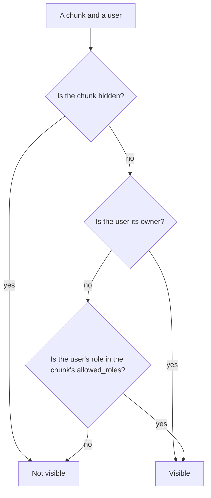
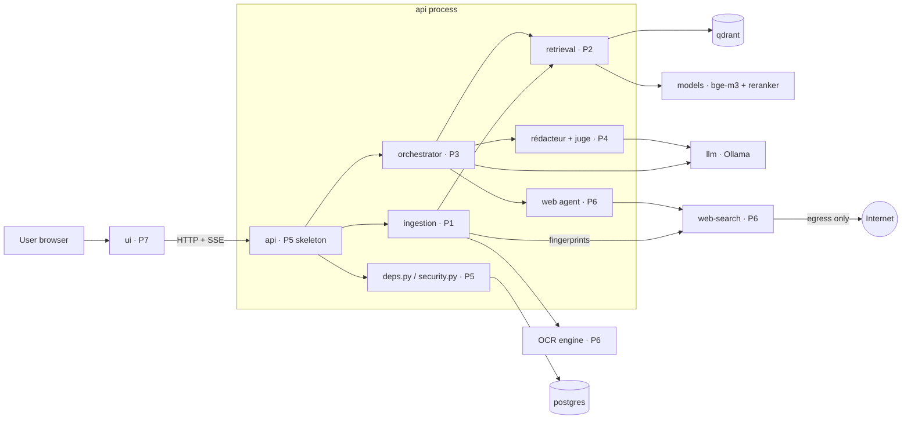
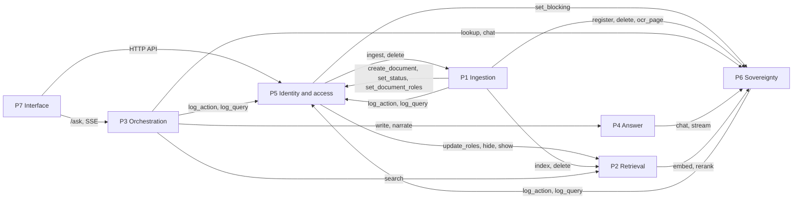
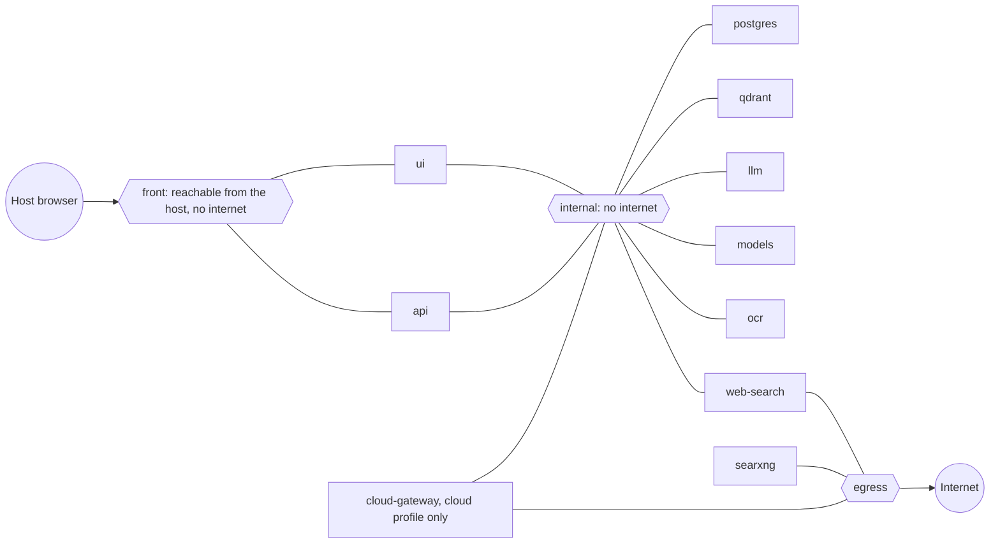
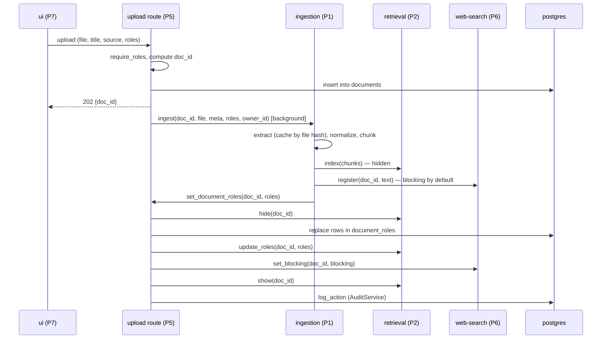
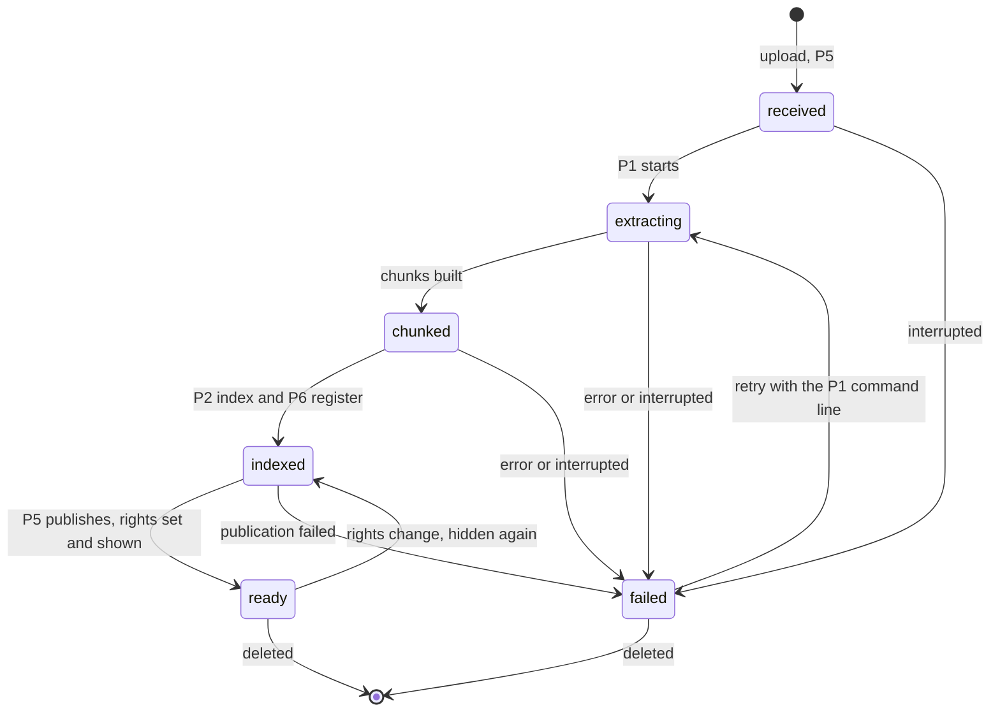
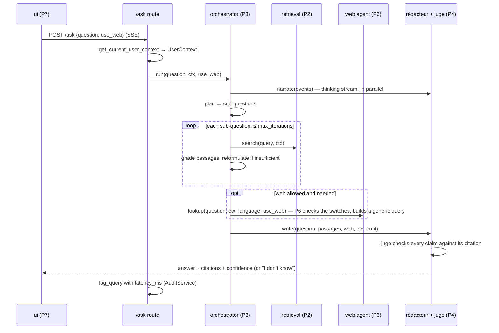
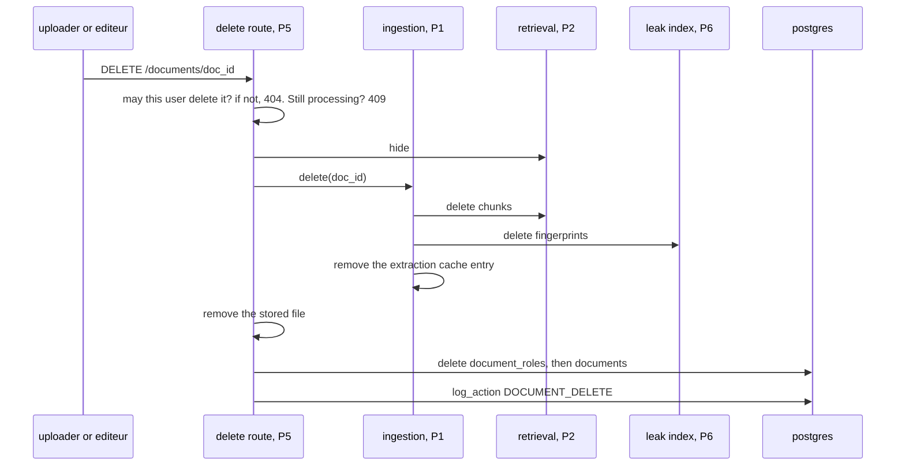
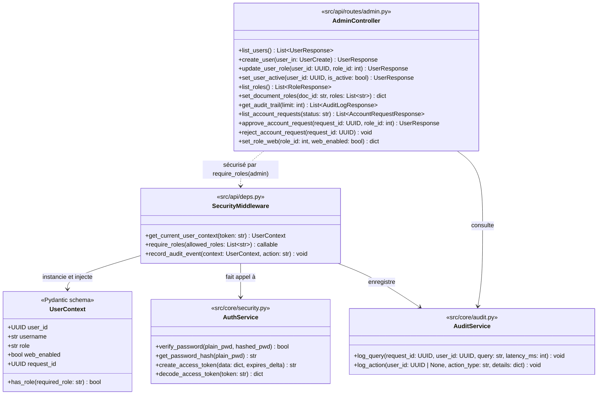
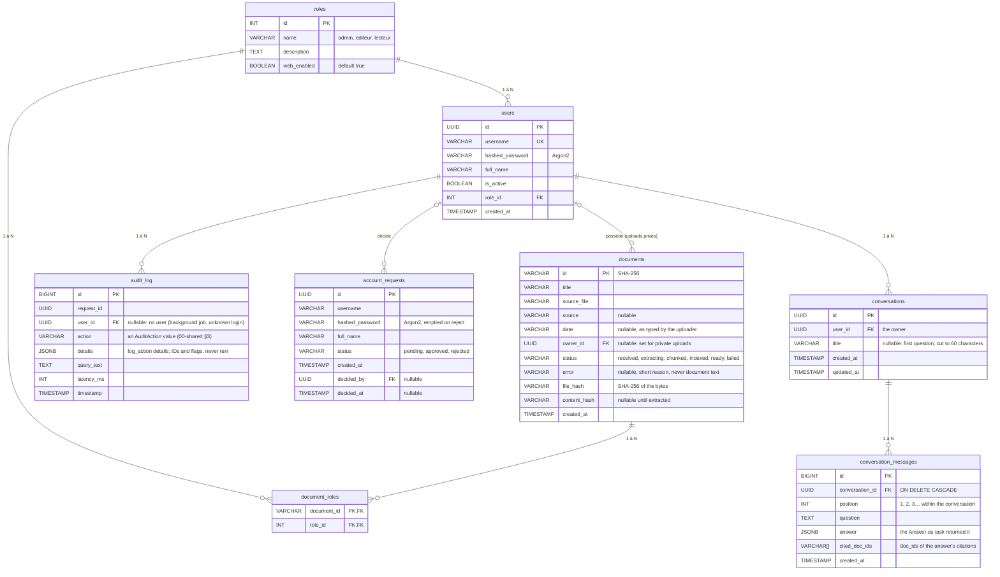

# Architecture — Assistant réglementaire marocain

> Status: **draft v0.2**.
> This document describes the whole system. Shared types, IDs and function signatures are defined in [`specs/00-shared.md`](specs/00-shared.md). Each part's detailed work is in `specs/P1-…` to `specs/P7-…`.

---

## 1. Purpose

An agentic RAG assistant that answers questions about Moroccan regulation (laws, decrees, Bulletin Officiel, internal circulars) from a corpus of **Arabic** documents. It decomposes the question, searches the corpus, checks that the passages are relevant, retries when they are not, writes an answer where every claim is backed by a citation (document, page, article, excerpt), returns a confidence score, and says "I don't know" when the corpus does not cover the question.

**Deployment framing.** The system is run by a Moroccan public administration, on its own servers. Questions may be asked in Arabic, French or Darija; the answer is written in French for a French question, and in standard Arabic for an Arabic or Darija question.

**Hard constraints** (checked by the jury, never traded off):

1. Access control is enforced **inside retrieval, before search**. Never by the prompt, never after the search.
2. Everything runs **locally** inside one `docker compose`. The final demo runs with the internet off.
3. The web search only ever receives a **generic reformulation** of the question. No corpus text, titles or metadata leave the system.
4. Ingested documents are **data, never instructions**.

---

## 2. Users, roles and document access

Roles come from the `roles` table: `admin`, `editeur`, `lecteur`. Each user has one role (`users.role_id`).

| Role | Who | Can do | Sees |
|---|---|---|---|
| `lecteur` | A citizen | Ask questions, upload private documents | Public documents + their own uploads |
| `editeur` | A jurist of the administration | Ask questions, add corpus documents and set their visibility (an editor's upload always goes to the corpus) | Public + internal documents |
| `admin` | The administrator | Accounts, roles, account requests, web search per role, document roles, deleting corpus documents, audit log | No corpus content, no private uploads |

A document is visible to the roles listed for it in `document_roles`:

| Document | `document_roles` | Visible to |
|---|---|---|
| Public | `["lecteur", "editeur"]` | `lecteur`, `editeur` |
| Internal | `["editeur"]` | `editeur` |
| Private upload | `[]` + `owner_id` | Its owner only |

A user sees a document when their `role` is in the document's roles, or when they own it. `admin` is never in a document's roles, so the admin sees no document content. The admin does see corpus document titles in the document list, to change their rights; never their content, and never private uploads. A document is public when `"lecteur"` is in its roles.



This is the only rule. P2 applies it inside Qdrant and BM25, before any search.

At each request, P5 builds a `UserContext`:

| Field | Meaning |
|---|---|
| `user_id` | The user's UUID |
| `username` | The user's login |
| `role` | The user's role name. Passed (inside `UserContext`) to every retrieval call. |
| `web_enabled` | Whether web search is allowed for the user's role (`roles.web_enabled`, set by the admin) |
| `request_id` | The request's UUID, for logs and audit |
| `has_role(required_role)` | Used by `require_roles` |

**Private uploads.** A document uploaded by a user (not by an editor) is visible only to that user.

**Deny by default:** a chunk with no rights attached is invisible to everyone. A document becomes searchable only when its rights are set through `set_document_roles` (§7.1).

---

## 3. System overview



---

## 4. Parts and ownership

| Part | Owns | Code |
|---|---|---|
| **P1** Ingestion | Extraction, OCR logic, Arabic normalization, chunking by article, ingestion pipeline and statuses, deletion of content | `src/ingestion/` |
| **P2** Retrieval | Embedding, Qdrant + BM25 indexes, role filter before search, RRF fusion, re-ranking, hide/show and rights updates in the indexes | `src/retrieval/` |
| **P3** Orchestration | LangGraph graph: planner, search loop, grading, reformulation, iteration and token budgets, web decision, process events | `src/agents/orchestrator/` |
| **P4** Answer | Rédacteur (answer with citations), Juge (claim/citation verification), confidence score, "I don't know", narrator (thinking stream) | `src/agents/answer/` |
| **P5** Identity and access | API skeleton, `AuthService`, `SecurityMiddleware`, `UserContext`, `AuditService`, `AdminController`, DB schema and migrations | `src/core/security.py`, `src/core/audit.py`, `src/api/deps.py`, `src/api/routes/admin.py`, `src/core/db/` |
| **P6** Sovereignty | Model serving, `LLMClient` / `ModelsClient` / `OCRClient`, web agent, `web-search` container, leak index and filter, Docker networks | `src/core/llm/`, `src/core/leak/`, `src/agents/web/`, `services/web-search/`, `services/models/` |
| **P7** Interface | Chat UI with thinking block and citations, upload, login, editor and admin screens, RTL rendering | `src/ui/` |

Shared and owned by nobody alone: `src/core/contracts/` (changed only through the process in §16). `src/core/config.py` and `src/core/logging.py` are created by P5 on day 1.

Who calls whom (each arrow is a contract of 00-shared §6, reached through `get_*()`; until the real one is ready, the caller uses the fake):



---

## 5. Runtime services (`docker-compose.yml`)

| Service | Content | Networks | Notes |
|---|---|---|---|
| `api` | FastAPI app: P1, P2, P3, P4, P5 and the P6 web agent code; also runs P1's command line | `internal` + `front` | Publishes `:8000` to the host (OpenAPI docs). Volumes `uploads` → `storage/uploads`, `extract_cache` → `cache/extracted`, `indexes` → `data/indexes`; `data/raw` (the corpus) mounted read-only |
| `ui` | P7 app | `internal` + `front` | Publishes its port to the host |
| `postgres` | PostgreSQL | `internal` | Volume `pg_data` |
| `qdrant` | Qdrant | `internal` | Volume `qdrant_data` |
| `llm` | Ollama | `internal` | Models pre-pulled by `make models` |
| `models` | bge-m3 embeddings + bge-reranker-v2-m3 (HTTP) | `internal` | Always local, in every mode |
| `ocr` | OCR engine (HTTP) | `internal` | Engine chosen by P1's benchmark |
| `web-search` | Search proxy + leak filter + leak index | `internal` + `egress` | The only entry point to the internet for the app. Volume `leak_data` (the leak index) |
| `searxng` | Self-hosted search engine, called only by `web-search` | `egress` | No access to `internal` |
| `cloud-gateway` | Proxy to a cloud LLM/OCR API | `internal` + `egress` | Profile `cloud` only, dev only |

- `internal` is declared with `internal: true`: containers on it cannot reach the internet.
- `front` is a bridge network with IP masquerade turned off: the host's browser can reach `ui` and `api` through it, and it has no route to the internet.
- Profiles: default = `local` (Qwen 2.5 7B), `light` (Qwen 2.5 3B), `cloud` (adds `cloud-gateway`).
- `make models` downloads every model ahead of time, so `docker compose up` works offline.



Only `web-search`, `searxng` and `cloud-gateway` touch `egress`; every query that reaches `searxng` has passed the leak filter inside `web-search`.

---

## 6. Repository layout

```
.
├── src/
│   ├── core/
│   │   ├── contracts/      # shared types, Protocols, fakes (see 00-shared.md)
│   │   ├── config.py       # loads .env + config.yaml
│   │   ├── logging.py      # JSON logs with request_id
│   │   ├── security.py     # AuthService (P5)
│   │   ├── audit.py        # AuditService (P5)
│   │   ├── db/             # SQLAlchemy models, migrations (P5)
│   │   ├── llm/            # LLMClient, ModelsClient, OCRClient (P6)
│   │   └── leak/           # fingerprints for the leak index (P6)
│   ├── ingestion/          # P1
│   ├── retrieval/          # P2
│   ├── agents/
│   │   ├── orchestrator/   # P3
│   │   ├── answer/         # P4
│   │   └── web/            # P6
│   ├── api/
│   │   ├── main.py         # app + middleware (P5)
│   │   ├── deps.py         # SecurityMiddleware (P5)
│   │   └── routes/         # admin.py (P5), one router per part
│   └── ui/                 # P7
├── services/               # web-search/, models/ (P6)
├── tests/                  # mirrors src/, plus tests/e2e/
├── evaluation/             # dataset.jsonl (50+ questions), run_eval.py
├── docs/                   # architecture.md, schedule.md, partition.md, specs/, evaluation.md, demo.md
├── data/raw/               # source documents
├── data/processed/         # files written by the fakes
├── data/indexes/           # retrieval.version (P2)
├── storage/uploads/        # original uploaded files (P5)
├── cache/extracted/        # extraction cache, one file per doc_id (gitignored)
├── config.yaml
├── .env.example
└── docker-compose.yml
```

---

## 7. Main flows

### 7.1 Upload and publication



- Any step fails → the document stays hidden, the failure is logged with `log_action`.
- Pipeline statuses: `received → extracting → chunked → indexed → ready`, or `failed` from any step.



A document is searchable only in `ready`. Every other status keeps it hidden.

### 7.2 Rights change

`AdminController.set_document_roles(doc_id, roles)` runs the same sequence as the end of §7.1: **hide → `document_roles` → P2 `update_roles` → P6 `set_blocking` → show**. A failure leaves the document hidden; nothing is ever briefly visible to the wrong role.

### 7.3 Question answering



- The SSE stream carries two kinds of events: `thinking` (narration, shown in a collapsible block) and `answer` (sent only **after** the Juge has verified it).
- The narrator receives process data only (sub-questions, counts, titles the user may see, the Juge's reasons), never passage contents, and makes no legal claims.
- A web query blocked by the leak filter, or web turned off by the admin, is narrated neutrally ("web search skipped"). When the user turned it off with the chat toggle, the narration may say so ("web search off, your choice").

### 7.4 Deletion




P5 hides the document → P1 `delete(doc_id)` removes chunks from P2's indexes and fingerprints from P6 → P5 deletes the rows in `documents` and `document_roles` → `log_action`. P1 also removes the document's extraction cache entry (`cache/extracted/<doc_id>.json`).

---

## 8. Document identity

`documents.id` is a SHA-256 hash, as in the schema.

| Value | Computed from | Used for |
|---|---|---|
| `documents.id` (`doc_id`) | `sha256(scope + file_bytes)`, `scope` = the uploader's `user_id` for private uploads, `"corpus"` otherwise | Identity everywhere, from upload on |
| file hash | `sha256(file_bytes)` | Stored in `documents.file_hash` |
| content hash | `sha256(normalized_text)` | Duplicate warning for the editor |
| `chunk_id` | `uuid5(NAMESPACE, f"{doc_id}:{chunk_index}")` | Qdrant point ID, BM25 key |

- Same file uploaded by two users → different `doc_id`, extracted separately. The extraction cache is per document (`cache/extracted/<doc_id>.json`), so an upload never reveals, by its speed or its outcome, that someone else has the same file.
- Same file added twice to the corpus → same `doc_id` → rejected as duplicate.
- Duplicate warnings (`duplicate_of`) compare **only within the same scope**: corpus documents with corpus documents, a user's uploads with that user's own uploads. A user is never told about another user's document.

---

## 9. Security model

### 9.1 Security components (P5)



### 9.2 Rules

| Rule | Where it is enforced | Owner |
|---|---|---|
| Every request (except login) carries a valid token | `get_current_user_context` | P5 |
| Route permissions | `require_roles([...])` | P5 |
| A retrieval call without `UserContext` is rejected | `search()` | P2 |
| Role filter (`ctx.role` in the chunk's `allowed_roles`, or owner) applied **inside** Qdrant and BM25 **before** search | `search()` | P2 |
| Unauthorized users never learn a restricted document's content, title or existence | P2 filter + P4 wording | P2, P4 |
| Chunks without rights are invisible | indexes (hidden by default) | P2 |
| Web search receives only a generic reformulation | web agent | P3, P6 |
| Every query sent to `web-search` is checked against the leak index | `web-search` container | P6 |
| Web search runs only if allowed globally (`config.yaml`), for the user's role (`roles.web_enabled`, set by the admin) and by the user for this question (`use_web`); the user can turn it off, never on against the admin | web agent `lookup` | P5, P6 |
| Document text is wrapped as data in every prompt; agent tools are a fixed whitelist | prompt templates, graph | P3, P4 |
| Iterations and tokens per request are capped | graph config | P3 |
| Queries and actions are audited | `AuditService.log_query`, `log_action`, `record_audit_event` | P5 |

**Do NOT:**
- filter results by role after the search;
- put role rules in a prompt;
- send any chunk, title or metadata to `web-search`;
- give any container other than `web-search`, `searxng` (and `cloud-gateway` in dev) access to the `egress` network.

---

## 10. Models and providers

| Use | Default (`local`) | `light` | `cloud` (dev only) |
|---|---|---|---|
| Planner, rédacteur, juge | Qwen 2.5 7B (Ollama) | Qwen 2.5 3B | Cloud LLM via `cloud-gateway` |
| Narration | Qwen 2.5 0.5B–1.5B | Templates | Small cloud model |
| Embeddings | bge-m3 | bge-m3 | bge-m3 (always local) |
| Re-ranking | bge-reranker-v2-m3 | same | same (always local) |
| OCR | Local engine | same | Optional cloud fallback |

- Business code only uses `LLMClient`, `ModelsClient` and `OCRClient` (P6). Implementations: `OllamaClient`, `GatewayClient`, `FakeLLMClient`.
- The app refuses to start in cloud mode unless `ALLOW_CLOUD_LLM=true`, and cloud mode is used only on public documents.

---

## 11. API surface

| Endpoint | Who | Part |
|---|---|---|
| Login (returns the token from `create_access_token`) | anyone | P5 |
| Current user: role and whether web search is available | any user | P5 |
| Request an account (username, password, full name); the admin approves or rejects it | anyone, no token | P5 |
| Upload a document | `editeur`, or any user for a private upload | P5 → P1 |
| List documents (own uploads; the corpus for `editeur` and `admin`) | any user | P5 |
| Document status | uploader or `editeur` | P5 |
| Delete a document | the uploader; `editeur` or `admin` for a corpus document | P5 → P1 |
| `/search` | any user | P2 |
| `/ask` (SSE), with a per-question `use_web` toggle | any user | P3 |
| Conversation history: list, create, open, add an exchange, delete | the owner only | P5 |
| `AdminController`: `list_users`, `create_user`, `update_user_role`, `set_user_active`, `list_roles`, `set_document_roles`, `get_audit_trail`, `list_account_requests`, `approve_account_request`, `reject_account_request`, `set_role_web` | `admin` (`require_roles([admin])`) | P5 |

Paths, request and response models: `00-shared.md`. OpenAPI docs are generated at `/docs`.

---

## 12. Data stores

| Store | Holds | Owner |
|---|---|---|
| PostgreSQL | `roles`, `users`, `documents`, `document_roles`, `audit_log`, `account_requests`, `conversations`, `conversation_messages` (schema below) | P5 (single owner of all migrations) |
| Qdrant | One collection of chunk vectors; payload = the whole chunk + a hidden flag. The only store of chunks | P2 |
| BM25 | In-memory index over normalized chunk text, rebuilt from Qdrant after every change | P2 |
| Leak index | HMAC'd n-gram fingerprints + document-frequency stats, inside `web-search`, volume `leak_data` | P6 |
| Extraction cache | `cache/extracted/<doc_id>.json`, volume `extract_cache` of `api` | P1 |
| Original files | `storage/uploads/<doc_id>.<ext>` on the volume `uploads` of `api` (internal network only), deleted with the document; `<ext>` is the extension of `documents.source_file` | P5 |

Other parts never write to a store they don't own; they call the owner's function.

### PostgreSQL schema (P5)



---

## 13. Configuration

- **`.env`**: secrets and deployment switches only (`POSTGRES_PASSWORD`, `JWT_SECRET`, `ADMIN_USERNAME`, `ADMIN_PASSWORD`, `LEAK_HMAC_KEY`, `LEAK_API_TOKEN`, `SEARXNG_SECRET`, `ALLOW_CLOUD_LLM`). Never committed; `.env.example` is.
- **`config.yaml`**: everything else (model names, `max_iterations`, token budget, top-k values, thresholds, and the `fake` / `real` choice for each contract during development). Keys are listed in `00-shared.md`.

---

## 14. Development approach

1. **Contracts first.** On days 1–2 every part merges, for each function it provides: the signature in `src/core/contracts/`, a **fake** implementation, and a contract test that both the fake and the real implementation must pass.
2. **Real work starts immediately.** Each part builds its real implementation from day 1 and uses the others' fakes wherever it touches another part.
3. **No code switch at integration.** `config.yaml` selects `fake` or `real` per contract. Moving to the real system changes configuration, not code.
4. **Files before databases.** Fakes write to plain files (`data/processed/chunks.jsonl`, a JSON status file), which also serve as test data for the next part.

Day 0 (Mon 2026-11-09) is for reading the documents; day 1 is Tue 2026-11-10; submission is on day 13 (Sun 2026-11-22). Checkpoints: **day 2** contracts and fakes merged · **day 5** each part works end to end with fakes · **day 8** full integration, mandatory tests green. The full two-week plan (evaluation, tuning, report, demo rehearsals) is in [`schedule.md`](schedule.md).

---

## 15. Logging, audit and tests

- JSON logs on stdout; every line carries `request_id`.
- Audit goes through `AuditService` (`log_query`, `log_action`) and `record_audit_event`, into `audit_log`.
- **Mandatory tests:**
  - (a) a user never retrieves a chunk reserved for another role, nor another user's private upload — through HTTP, for every role;
  - (b) no web request contains corpus text.
- **End-to-end test** (`tests/e2e/`, P5 T39): an editor uploads a document as public → wait for `ready` → a lecteur asks (with `use_web = false`) → answer with a valid citation; then the admin sets the document to internal → the lecteur's same question returns `unknown` ("I couldn't find this information in the documents available to you"), identical to a question the corpus does not cover.
- Prompt-injection test: a document containing instructions does not change the system's behaviour.
- Coverage ≥ 60 % on chunking, retrieval and agents.

---

## 16. Working process

1. **One branch per task**, named `type/<short-desc>`, e.g. `feat/hybrid-search`. Never push to `main`.
2. **Commits** follow Conventional Commits: `feat(retrieval): add RRF fusion`.
3. **One pull request per branch.**
4. **Approval by the code owners.** `.github/CODEOWNERS` lists the owners of each folder; a PR can be merged only once the owners of every file it changes have approved it. Changes to `00-shared.md` or `src/core/contracts/` need approval from the parts that use the contract.
5. **Merge** with "Squash and merge" once CI is green.

