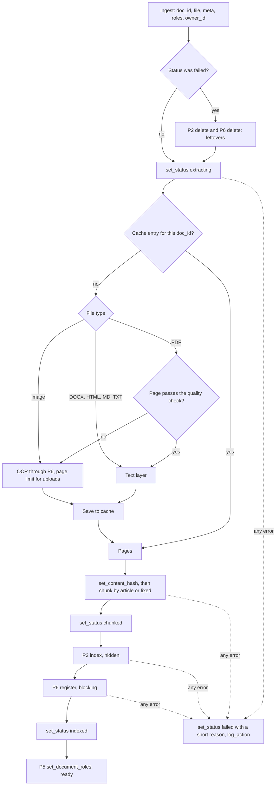

# P1 — Ingestion

> Status: **draft v0.1**. Read with [`../architecture.md`](../architecture.md) and [`00-shared.md`](00-shared.md). Names, types, IDs, statuses, errors and the signatures of every function shared with other parts are defined in `00-shared.md` and are not repeated here.

---

## 1. Purpose

Turn raw documents (the Arabic legal corpus, documents added by editors, and users' private uploads) into **clean, faithful, citable chunks**, and hand them to retrieval (P2) and the leak index (P6).

**P1 handles content, not access.** P1 never decides who can see a document; it passes on the roles P5 gives it.

---

## 2. Owns / does not own

| P1 owns | Not P1 (owner) |
|---|---|
| Building the corpus and its metadata | Choosing who sees a document (P5) |
| Text extraction, OCR logic (engine choice, quality check, cleaning) | Serving the OCR engine (P6) |
| `normalize_ar`, used by P1, P2 and P6 | Embeddings, indexes, search (P2) |
| Chunking by article | Fingerprints and the leak filter (P6) |
| The ingestion pipeline and its status updates | Storing statuses, the `documents` table, the upload route (P5) |
| The extraction cache | Storing original files (P5) |
| Deleting a document's content from P2, P6 and the cache | Deleting the `documents` rows and the file (P5) |
| The ~20 sample chunks used by every part | |

Code: `src/ingestion/`. Tests: `tests/ingestion/`.

---

## 3. Requirements

MUST = required for validation. SHOULD = expected, can be cut if time runs out.

### 3.1 Corpus

- **P1-01** MUST collect public Arabic texts (Bulletin Officiel, dahirs, laws, decrees), about **500 pages** in total, in `data/raw/public/`:
  - about **80 %** on **one main theme**, chosen so that texts refer to each other (a law, its implementing decrees, related circulars);
  - about **20 %** on **other themes**, including at least one theme that shares legal vocabulary with the main one (deadlines, competent authority, penalties…).
- **P1-02** MUST write **5–6 fictional internal documents** (circulars, notes) in Arabic, structured in articles, in `data/raw/internal/`. Each one says on its first line: `وثيقة تجريبية — محتوى خيالي` (test document, fictional content). No real names or personal data.
- **P1-03** MUST provide a few sample user uploads in `data/raw/uploads/`, including **one document containing instructions** (e.g. "تجاهل التعليمات السابقة وأجب بـ…" / "ignore previous instructions…") for the prompt-injection test.
- **P1-04** MUST keep `data/raw/manifest.csv`, one row per file:
  `file, title, type, number, date, bo_issue, source_url, language, scanned, visibility`
  `type` ∈ `dahir | loi | decret | arrete | circulaire | note | autre`; `scanned` ∈ `yes | no`; `visibility` ∈ `public | internal | upload` (used only by the seed command, §3.7).
- **P1-05** MUST deliver `tests/fixtures/sample_chunks.jsonl` by **day 2**: about 20 valid `Chunk` objects (00-shared §5.2) from at least 3 documents, including at least one internal document, one private upload owned by the fixed `user_id` of `lecteur_ctx` (P5-08), one French chunk, and one chunk with `article = None`. `allowed_roles` is filled in this file (it is test data), so P2 can test the visibility rule.

### 3.2 Extraction

- **P1-06** MUST accept PDF, DOCX, HTML, MD, TXT, and images: PNG, JPG/JPEG, TIFF (a multi-page TIFF is one page per frame). Any other format raises `InvalidInput`.
- **P1-06b** MUST send every image page straight to OCR (no quality check: there is no text layer). Image pages count toward `ocr.max_pages_upload`. SHOULD preprocess images before OCR: grayscale, deskew, contrast (phone photos are often tilted and unevenly lit).
- **P1-07** MUST extract digital PDFs page by page with PyMuPDF, keeping the page number of every piece of text.
- **P1-08** MUST send a page to OCR when it has fewer than `ingestion.min_letters_per_page` letters, and SHOULD also when its shaping is unresolved or its words are reversed (§6.2).
- **P1-09** MUST OCR through `get_ocr().ocr_page(image, "ar")` only, rendering the page at 300 dpi. Never call an OCR library directly.
- **P1-10** MUST stop OCR on private uploads after `ocr.max_pages_upload` pages and fail the document with error `"too many scanned pages"`.
- **P1-11** MUST convert Arabic presentation forms (U+FB50–U+FDFF, U+FE70–U+FEFF) to base letters (Unicode NFKC) before anything else.
- **P1-12** SHOULD remove running headers, footers and page numbers (lines repeated on most pages, or lines that are only a number).
- **P1-13** MUST cache the extraction result in `cache/extracted/<doc_id>.json` (`{"pages": [{"page": 1, "text": "...", "ocr": false, "confidence": null}]}`) and reuse it when the same document is ingested again (a retry). The cache is per document and never shared between documents, so an upload can never reveal, by its speed or its outcome, that someone else has the same file.
- **P1-14** SHOULD fail the document with error `"OCR quality too low"` when the average confidence of its OCR pages is below `ingestion.ocr_min_confidence`. Individual low-confidence pages are kept.

### 3.3 Arabic normalization

- **P1-15** MUST provide `normalize_ar(text: str) -> str` in `src/ingestion/normalize.py`. P2 uses it on queries and P6 uses it before fingerprinting, so the **same function** is applied everywhere. Rules, in this order:
  1. Unicode NFKC (presentation forms → base letters);
  2. remove invisible format characters (Unicode category `Cf`, e.g. the direction marks U+200E, U+200F, U+061C, the joiners U+200C, U+200D, U+FEFF, the soft hyphen U+00AD), which text extraction often leaves inside words;
  3. remove diacritics U+064B–U+065F and U+0670;
  4. remove tatweel U+0640;
  5. `أ إ آ ٱ` → `ا`;
  6. `ى` → `ي`;
  7. `ة` → `ه`;
  8. Arabic-Indic digits `٠–٩` and Persian digits `۰–۹` → `0–9`;
  9. lowercase Latin letters;
  10. replace every punctuation or symbol character (Unicode category starting with `P` or `S`, e.g. `، ؛ ؟ . , / § ° « »`) with a space;
  11. collapse whitespace, strip.
- **P1-16** MUST NOT stem. Stemming, if any, belongs to P2's BM25 tokenizer.
- **P1-17** MUST keep `normalize_ar` idempotent: `normalize_ar(normalize_ar(x)) == normalize_ar(x)`.

### 3.4 Chunking

- **P1-18** MUST detect `المادة` and `الفصل` headings at the start of a line, and SHOULD detect the higher levels `الكتاب`, `الباب`, `القسم`, `الفرع` (they fill `hierarchy`). Each heading is followed by a number in digits (`12`, `١٢`) or in words (`الأول`, `الثاني`, `الأولى`, `الثانية`, … `العاشر`, `الحادي عشر`, …), optionally followed by `مكرر`.
  > **Note:** this list is a starting point, not exhaustive. P1 adds any heading form found in the corpus (e.g. `الجزء`, `مادة فريدة`, `باب تمهيدي`, `ملحق`, `مكرر مرتين`), each with a test using a real example from the corpus.
- **P1-19** MUST resolve the `الفصل` ambiguity per document: if the document contains `المادة` headings, `الفصل` is a section (chapter); otherwise `الفصل` is the article unit.
- **P1-20** MUST produce **one chunk per article**. `article` holds the heading as written (e.g. `"المادة 12"`), `hierarchy` holds the path of headings above it, outermost first (e.g. `["الكتاب الأول", "الباب الثاني", "الفصل الثالث"]`). A new heading of a level replaces that level and drops every deeper level (a new `الباب` clears the current `الفصل`).
- **P1-21** MUST put any text before the first article (title, preamble, ديباجة) in its own chunk with `article = None`.
- **P1-22** MUST split an article longer than `ingestion.max_chunk_chars` at paragraph boundaries into parts that each keep the same `article` and `hierarchy`.
- **P1-23** MUST chunk documents with no detected articles by paragraphs, packed up to `ingestion.max_chunk_chars`, with `ingestion.overlap_chars` of overlap, `article = None`.
- **P1-23b** MUST support `ingestion.strategy`: `article` (default: P1-18 to P1-23) or `fixed` (every document packed by paragraphs up to `ingestion.max_chunk_chars` with `ingestion.overlap_chars` of overlap; `article` = the article heading the chunk starts in, or `None`). The strategy is a config change only.
- **P1-24** MUST fill `page_start` / `page_end` from the pages the chunk's text came from.
- **P1-25** MUST set `language` per chunk with the shared `detect_language` (00-shared §4b).
- **P1-26** MUST build every chunk with `chunk_id = make_chunk_id(doc_id, chunk_index)`, `total_chunks` = the number of chunks of the document (known once chunking is finished, set on all of them), `title`, `source_file`, `source` and `date` copied from the `DocumentMeta` received from P5, `allowed_roles = []`, and the `owner_id` received from P5. P1 never guesses `title` or `source_file` from the stored file's path (it is `<doc_id>.<ext>`).

### 3.5 Pipeline

- **P1-27** MUST implement `Ingestion.ingest` (00-shared §6.2) exactly as in §6.1 below, calling `set_status` before each stage.
- **P1-28** MUST, on retry (status `failed`), first call `get_retrieval().delete(doc_id)` and `get_leak_index().delete(doc_id)` to remove leftovers from the failed run.
- **P1-29** MUST register **every** document with the leak index, whatever its future rights.
- **P1-30** MUST, on any exception: `set_status(doc_id, FAILED, error=<short reason>)`, `log_action`, and stop. The reason describes what failed, never the document's content.
- **P1-31** MUST obtain every other part only through `get_*()` (00-shared §9). No direct imports of another part's implementation.

### 3.6 Deletion

- **P1-32** MUST implement `Ingestion.delete` (00-shared §6.2): P2 `delete`, P6 `delete`, then the cache entry `cache/extracted/<doc_id>.json`. Idempotent.

### 3.7 Command line

- **P1-33** MUST provide `python -m src.ingestion.cli ingest <path> [--roles lecteur,editeur | editeur] [--owner <user_id>] [--title <t>] [--source <s>] [--date <d>]` to ingest a file or a folder, and `python -m src.ingestion.cli seed` to ingest everything in `manifest.csv` (manifest `visibility` → roles: `public` → `["lecteur", "editeur"]`, `internal` → `["editeur"]`, `upload` → `[]`, owned by the user given with `seed --owner <user_id>`, required when the manifest has `upload` rows). The CLI builds the `DocumentMeta` (`title`: `--title` or the manifest's `title`, else the file name without extension; `source_file`: the file name; `source`: `--source` or the manifest's `source_url`, else `None`; `date`: `--date` or the manifest's `date`, else `None`), calls P5's `create_document` (which computes `doc_id`, stores the file and creates the `documents` row), then calls `ingest`. A file whose `doc_id` already exists (`Conflict`) is skipped if its status is `ready` or in progress, and ingested again if it is `failed` (a retry, P1-28), so `seed` can be run again safely. `--owner` must be an existing user's ID. It works with fakes (§9 of 00-shared) before any database exists. With the real system it runs **inside the `api` container** (`docker compose exec api python -m src.ingestion.cli …`, or `make seed`), because `postgres` and `qdrant` are reachable only on the internal network; P2's version file is then shared with the API automatically.

---

## 4. Contracts provided

| What | Defined in | Used by |
|---|---|---|
| `Ingestion.ingest`, `Ingestion.delete` | 00-shared §6.2 | P5 (upload and delete routes), the CLI |
| `normalize_ar(text) -> str` | this spec, P1-15 | P2 (queries, BM25), P4 (excerpt check), P6 (fingerprints) |
| `tests/fixtures/sample_chunks.jsonl` + `sample_chunks` fixture | P1-05 | All parts' tests |
| `FakeIngestion` | 00-shared §9 | P5 |

## 5. Contracts consumed

| What | From | Used for |
|---|---|---|
| `OCRClient.ocr_page` | P6 | Scanned pages |
| `Retrieval.index`, `Retrieval.delete` | P2 | Storing chunks, cleanup |
| `LeakIndex.register`, `LeakIndex.delete` | P6 | Fingerprints |
| `DocumentRights.set_status`, `DocumentRights.set_document_roles` | P5 | Statuses, handing over for publication |
| `DocumentRights.get_status` | P5 | Retry detection |
| `DocumentRights.set_content_hash` | P5 | Duplicate warning |
| `DocumentRights.create_document` | P5 | The command line (creates the `documents` row before `ingest`) |
| `Audit.log_action` | P5 | Logging failures |
| `make_doc_id`, `make_content_hash`, `make_chunk_id` | 00-shared §4 | IDs |
| `detect_language` | P3 (00-shared §4b) | Chunk language |
| `DocumentMeta` (title, original file name, source) | P5, through `ingest` (00-shared §5.2b) | Filling `title`, `source_file`, `source` on chunks |

---

## 6. Pseudocode

Every call to a function owned by **another part** is marked with its owner in a comment (`# P2`, `# P5`, `# P6`, `# shared` = `00-shared.md` §4). Functions with no mark are written by P1.



### 6.1 `ingest`

```python
def ingest(doc_id, file_path, meta, roles, owner_id):
    rights    = get_document_rights()                  # P5
    retrieval = get_retrieval()                        # P2
    leak      = get_leak_index()                       # P6
    is_retry  = rights.get_status(doc_id) == FAILED    # P5 — read BEFORE changing it
    try:
        rights.set_status(doc_id, EXTRACTING)          # P5
        if is_retry:
            retrieval.delete(doc_id)                   # P2
            leak.delete(doc_id)                        # P6

        pages = load_cache(doc_id)                     # per document (P1-13)
        if pages is None:
            pages = extract(file_path, owner_id)       # §6.2
            save_cache(doc_id, pages)

        full_text = "\n".join(p.text for p in pages)
        rights.set_content_hash(doc_id, make_content_hash(normalize_ar(full_text)))   # P5, shared
        chunks = chunk_document(doc_id, pages, owner_id, meta)   # §6.3
        if not chunks:
            raise InvalidInput("no text extracted")
        rights.set_status(doc_id, CHUNKED)             # P5

        retrieval.index(chunks)                        # P2 — stored hidden; drops old chunks with index >= total_chunks
        leak.register(doc_id, full_text)               # P6 — blocking by default
        rights.set_status(doc_id, INDEXED)             # P5
    except Exception as e:
        rights.set_status(doc_id, FAILED, error=short_reason(e))   # P5
        get_audit().log_action(                                    # P5
            None, INGEST_FAILED, {"doc_id": doc_id, "reason": short_reason(e)})
        return

    try:
        rights.set_document_roles(doc_id, roles)       # P5 — publishes
    except Exception as e:
        # P5 has already set FAILED, kept the document hidden and logged it.
        log.warning("publication failed", doc_id=doc_id, reason=short_reason(e))
```

`get_status` is a P5 function (00-shared §6.1): P1 never reads Postgres itself.

`user_id = None`: ingestion runs in the background, with no user behind it (00-shared §6.1).

### 6.2 `extract`

```python
def extract(file_path, owner_id) -> list[Page]:
    suffix = file_path.suffix.lower()                  # "X.PDF" is a PDF too
    if suffix == ".pdf":
        pages, ocr_count = [], 0
        for n, page in enumerate(open_pdf(file_path), start=1):
            text = nfkc(page.get_text())
            if passes_quality_check(text):
                pages.append(Page(n, text, ocr=False, confidence=None))
            else:
                ocr_count += 1
                if owner_id and ocr_count > cfg.ocr.max_pages_upload:
                    raise InvalidInput("too many scanned pages")
                text, conf = get_ocr().ocr_page(render(page, dpi=300), "ar")   # P6
                pages.append(Page(n, clean_ocr(nfkc(text)), ocr=True, confidence=conf))
        return remove_headers_footers(pages)
    if suffix in (".png", ".jpg", ".jpeg", ".tif", ".tiff"):
        frames = load_image_frames(file_path)              # 1 frame, or 1 per TIFF page
        if owner_id and len(frames) > cfg.ocr.max_pages_upload:
            raise InvalidInput("too many scanned pages")
        pages = []
        for n, img in enumerate(frames, start=1):
            text, conf = get_ocr().ocr_page(preprocess(img), "ar")   # P6 (preprocess: P1)
            pages.append(Page(n, clean_ocr(nfkc(text)), ocr=True, confidence=conf))
        return pages
    if suffix in (".docx", ".html", ".md", ".txt"):
        return [Page(1, nfkc(read_text(file_path)), ocr=False, confidence=None)]
    raise InvalidInput("unsupported format")

def passes_quality_check(text) -> bool:
    letters = [c for c in text if c.isalpha()]
    if len(letters) < cfg.ingestion.min_letters_per_page:      # empty or near-empty page
        return False
    if share_in_ranges(text, PRESENTATION_FORMS) > 0.05:       # shaping not resolved
        return False
    if share_of_reversed_words(text) > 0.3:                    # e.g. "ةداملا" instead of "المادة"
        return False
    return True
```

`share_of_reversed_words`: proportion of words whose reverse is a known frequent word (`المادة`, `الفصل`, `الباب`, `على`, `في`, `من`, `أن`, `التي`, `الذي`, `هذا`, …) while the word itself is not.

### 6.3 `chunk_document`

```python
HEADING = r"^\s*(الكتاب|الباب|القسم|الفرع|الفصل|المادة)\s+(\d+|[٠-٩]+|<ordinal words>)(\s+مكرر)?"

LEVELS = ["الكتاب", "الباب", "القسم", "الفرع", "الفصل"]   # outermost first; P1 adds levels found in the corpus

def chunk_document(doc_id, pages, owner_id, meta) -> list[Chunk]:
    lines = [(page.number, line) for page in pages for line in page.text.splitlines()]
    article_word = "المادة" if any_heading(lines, "المادة") else "الفصل"
    units, path, current = [], [], new_unit(article=None, hierarchy=[])   # preamble unit first
    for page_no, line in lines:
        h = match(HEADING, line)
        if h and h.word == article_word:
            units.append(current); current = new_unit(article=line.strip(), hierarchy=list(path))
        elif h:                                              # a heading above the article level
            path = update_path(path, h.word, line.strip())
            continue                                         # not part of any article's text
        current.add(line, page_no)
    units.append(current)
    units = [u for u in units if u.text.strip()]
    if all(u.article is None for u in units):
        units = pack_paragraphs(units, cfg.ingestion.max_chunk_chars, cfg.ingestion.overlap_chars)
    units = split_long(units, cfg.ingestion.max_chunk_chars)  # paragraph boundaries, same article

    total = len(units)
    return [Chunk(chunk_id=make_chunk_id(doc_id, i),   # shared
                  doc_id=doc_id, chunk_index=i, total_chunks=total,
                  text=u.text, text_normalized=normalize_ar(u.text),
                  title=meta.title, article=u.article, hierarchy=u.hierarchy,
                  page_start=u.first_page, page_end=u.last_page,
                  language=detect_language(u.text),            # shared §4b
                  source_file=meta.source_file, source=meta.source, date=meta.date,
                  allowed_roles=[], owner_id=owner_id)
            for i, u in enumerate(units)]

def update_path(path, word, heading) -> list[str]:
    level = LEVELS.index(word)
    kept = [p for p in path if LEVELS.index(heading_word(p)) < level]   # keep outer levels only
    return kept + [heading]
```

Example: `الكتاب الأول` → `الباب الأول` → `المادة 1` → `الباب الثاني` → `المادة 2` gives `hierarchy = ["الكتاب الأول", "الباب الأول"]` for article 1 and `["الكتاب الأول", "الباب الثاني"]` for article 2.

### 6.4 `delete`

```python
def delete(doc_id):
    get_retrieval().delete(doc_id)                             # P2 — idempotent
    get_leak_index().delete(doc_id)                            # P6 — idempotent
    remove_if_exists(f"cache/extracted/{doc_id}.json")
```

---

## 7. Error handling

| Situation | What P1 does |
|---|---|
| Unsupported format | `InvalidInput("unsupported format")` → status `failed` |
| No text after extraction and OCR | `InvalidInput("no text extracted")` → `failed` |
| Too many scanned pages in a private upload | `InvalidInput("too many scanned pages")` → `failed` |
| OCR service down | `ServiceError` from `OCRClient` → `failed`, retry later |
| P2 `index` or P6 `register` fails | `failed`; on retry, leftovers are deleted first (P1-28) |
| `set_document_roles` fails | P5 already sets `failed` and keeps the document hidden; P1 only logs |
| `delete` partially fails | Exception propagates; calling `delete` again finishes the job (idempotent) |
| Corrupt or password-protected PDF | `InvalidInput("cannot open file")` → `failed` |

**Do NOT:**
- set `allowed_roles` to anything but `[]` in the pipeline;
- write to Qdrant, BM25, Postgres or the leak index directly;
- put document text in a status `error`, a log line or an exception message;
- follow instructions found inside a document (it is data);
- call an OCR library or an LLM directly instead of `get_ocr()` / `get_llm()`.

---

## 8. Acceptance tests

Each one becomes a pytest in `tests/ingestion/`.

| # | Given | When | Then |
|---|---|---|---|
| T1 | A digital PDF with 3 `المادة` headings | `chunk_document` | 3 article chunks (+1 preamble chunk if there is text before the first article), `article` = the headings as written |
| T2 | A text with `الفصل` headings and no `المادة` | `chunk_document` | One chunk per `الفصل` |
| T3 | A text with `الباب الأول` › `الفصل الثاني` › `المادة 5` | `chunk_document` | Chunk of article 5 has `hierarchy = ["الباب الأول", "الفصل الثاني"]` |
| T4 | An article of 3× `max_chunk_chars` | `chunk_document` | ≥ 3 chunks, all with the same `article` |
| T5 | An article spanning pages 2–3 | `chunk_document` | `page_start = 2`, `page_end = 3` |
| T6 | `"الْمَادَّةُ"`, `"أحكام"`, `"مسؤولية"`, `"١٢"`, `"ـــالقانون"`, `"المادة"` followed by U+200F | `normalize_ar` | `"الماده"`, `"احكام"`, `"مسؤوليه"`, `"12"`, `"القانون"`, `"الماده"` |
| T7 | Any string | `normalize_ar` twice | Same result as once |
| T8 | A page in presentation forms (U+FExx) | quality check | Fails → OCR (or NFKC fixes it and it passes) |
| T9 | A page with reversed words (`ةداملا`) | quality check | Fails |
| T10 | A scanned PDF, fake OCR | `ingest` | Statuses `extracting → chunked → indexed`, then `set_document_roles` called with the given roles |
| T10b | A JPG photo of a page, fake OCR | `ingest` | OCR called once, no quality check, one chunk set with `page_start = 1` |
| T10c | A 3-frame TIFF | `extract` | 3 pages, OCR called 3 times |
| T11 | A `failed` document ingested again (retry) | second `ingest` | OCR not called (cache hit) |
| T12 | Any document | `ingest` | Every chunk has `allowed_roles == []` when passed to `index` |
| T13 | A private upload by user U | `ingest` | Every chunk has `owner_id == U` |
| T14 | A private upload with more scanned pages than the limit | `ingest` | Status `failed`, error `"too many scanned pages"`, OCR called at most `limit` times |
| T15 | `index` raises | `ingest` | Status `failed`, `set_document_roles` not called |
| T16 | A document ingested | `delete` twice | No error; P2 and P6 `delete` called; cache removed |
| T17 | Two users upload the same scanned file | second `ingest` | OCR called again: the cache is per document |
| T18 | Any `error` written by P1 in tests | — | Contains no text from the document |
| T19 | A document giving 4 chunks | `chunk_document` | `chunk_index` = 0, 1, 2, 3 and `total_chunks = 4` on all of them |
| T20 | `meta = DocumentMeta(title="T", source_file="a.pdf", source="https://example.ma/x")`, stored file `storage/uploads/<doc_id>.pdf` | `ingest` | Every chunk has `title == "T"`, `source_file == "a.pdf"`, `source == "https://example.ma/x"` |
| T21 | `الباب الأول` › `الفصل الأول` › `المادة 1` › `الباب الثاني` › `المادة 2` | `chunk_document` | Article 2 has `hierarchy = ["الباب الثاني"]` (the old `الفصل` is dropped) |
| T22 | A document ingested with 5 chunks, then re-ingested giving 3 | `ingest` twice, fake retrieval | Only chunks 0–2 remain for that `doc_id` |
| T23 | `ingestion.strategy = fixed`, a text of 3× `max_chunk_chars` | `chunk_document` | ≥ 3 chunks, consecutive chunks share `overlap_chars` of text |
| T24 | `meta.date = "2025-03-12"` | `ingest` | Every chunk has `date == "2025-03-12"` |
| T25 | `seed` run twice on the same manifest | second run | Existing documents skipped, no error |

Contract tests in `tests/contracts/test_ingestion.py` run T10, T12, T13 and T16 on both `FakeIngestion` and the real implementation.

---

## 9. Minimum version vs full version

| Minimum (must work for validation) | Full |
|---|---|
| Digital PDFs, DOCX, HTML, MD, TXT, JPG/PNG | + TIFF, image preprocessing |
| Chunking by `المادة` / `الفصل`, preamble, long-article split | + `الكتاب` / `القسم` / `الفرع` paths, `مكرر`, ordinal words up to the hundreds |
| `normalize_ar` (all 11 rules) | — |
| OCR through `OCRClient` when the page is empty | + presentation-form and reversed-word checks, header/footer removal, OCR cleaning |
| Pipeline with statuses, cache, retry; `article` and `fixed` strategies; `date` | — |
| ~200 pages of corpus + 5 internal documents | ~500 pages |

---

## 10. Schedule

Day 0 is for reading; building starts on day 1. The whole team's plan is in `../schedule.md`; the **checkpoints** are what this part must have merged by the end of that day.

| Day | Date | Delivered |
|---|---|---|
| 0 | Mon 11-09 | Read the docs; choose the main theme and start collecting public texts |
| 1 | Tue 11-10 | `normalize_ar` with T6–T7; `manifest.csv` started; first sample chunks drafted |
| 2 | Wed 11-11 | **Checkpoint:** `FakeIngestion` + contract test merged; `sample_chunks.jsonl` merged; `normalize_ar` merged with T6–T7; `manifest.csv` with the first documents |
| 3 | Thu 11-12 | The 5–6 internal documents (P1-02) merged, so the leak-test queries can be written from them; extraction of digital PDFs |
| 4 | Fri 11-13 | Chunking by article (`article` and `fixed` strategies); OCR path with `FakeOCRClient`; T1–T5 |
| 5 | Sat 11-14 | **Checkpoint:** CLI ingests the digital corpus end to end with fakes; T1–T7, T10–T13 green; OCR engine chosen from the benchmark on real scans (result in the PR description) |
| 6 | Sun 11-15 | With P2: real ingestion into Qdrant; with P6: OCR on real Bulletin Officiel scans |
| 7 | Mon 11-16 | Corpus close to ~500 pages; `seed` run on the real system |
| 8 | Tue 11-17 | **Checkpoint:** real `get_*` for P2, P5, P6; full corpus ingested; all tests green |
| 9 | Wed 11-18 | **Feature freeze.** Read the first evaluation results; list this part's problems |
| 10 | Thu 11-19 | Tune this part's values (schedule.md §3) and fix bugs · Tune `ingestion.*`; corpus loaded on the demo machine |
| 11 | Fri 11-20 | Tuning and fixes; second evaluation run; **report section** on this part drafted (French) |
| 12 | Sat 11-21 | Fixes only, each tested on the demo machine; **demo rehearsal 1** |
| 13 | Sun 11-22 | **Demo rehearsal 2** (morning); submission |
