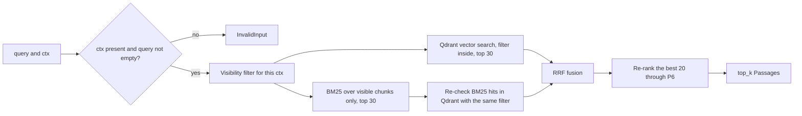

# P2 — Retrieval

> Status: **draft v0.1**. Read with [`../architecture.md`](../architecture.md) and [`00-shared.md`](00-shared.md). Names, types, IDs, statuses, errors and the signatures of every function shared with other parts are defined in `00-shared.md` and are not repeated here.

---

## 1. Purpose

Store the chunks produced by P1 and find, for a question, **the best passages this user is allowed to see**: vector search + BM25, fused with RRF, then re-ranked.

**P2 is where access control happens.** The role filter is applied inside Qdrant and BM25 **before** the search, never after it and never in a prompt. A chunk the user may not see is never scored, never returned, and never included in a count that is shown or logged.

---

## 2. Owns / does not own

| P2 owns | Not P2 (owner) |
|---|---|
| The Qdrant collection, its payload and its filters | Running Qdrant (P6, `docker compose`) |
| The BM25 index and its Arabic tokenizer | `normalize_ar` (P1) |
| Calling embeddings and re-ranking | Serving bge-m3 and the re-ranker (P6, `ModelsClient`) |
| The visibility filter (00-shared §6.3) | Deciding a document's roles (P5) |
| Hidden / shown state of chunks in the indexes | Document statuses and the publication sequence (P5) |
| RRF fusion, re-ranking, the final `Passage` list | Judging if passages are enough, reformulating (P3) |
| The `/search` route's logic | The FastAPI app and `UserContext` (P5) |
| `FakeRetrieval` and the retrieval contract test | Chunking (P1) |

Code: `src/retrieval/`, route `src/api/routes/search.py`. Tests: `tests/retrieval/`.

---

## 3. Requirements

MUST = required for validation. SHOULD = expected, can be cut if time runs out.

### 3.1 Storage

- **P2-01** MUST use **one** Qdrant collection, `retrieval.collection` (default `chunks`), with 1024-dimension vectors and cosine distance. `real_retrieval()` creates it, with its payload indexes, the first time it is called if it is missing, so neither the API nor P1's command line has to do it.
- **P2-02** MUST store each chunk as one Qdrant point: ID = `chunk_id`, payload = **every field of the `Chunk`** (00-shared §5.2) + `hidden: bool`. `owner_id` is stored as a string, or `null`.
- **P2-03** MUST create payload indexes on `doc_id`, `allowed_roles`, `owner_id` and `hidden`, so filters stay fast.
- **P2-04** MUST treat Qdrant as the **only** store. BM25 is rebuilt from Qdrant's payloads (§6.5); P2 keeps no other copy of the chunks.

### 3.2 Indexing (`index`)

- **P2-05** MUST implement `Retrieval.index` (00-shared §6.3) as in §6.1. It refuses with `InvalidInput`: an empty list, chunks from more than one `doc_id`, a `chunk_id` different from `make_chunk_id(doc_id, chunk_index)`, `total_chunks` not the same on all chunks, or `chunk_index` outside `0 … total_chunks - 1`.
- **P2-06** MUST store new chunks **hidden** (`hidden = True`), with the `allowed_roles` received (P1 always sends `[]`). Only `show` makes them searchable.
- **P2-07** MUST embed the **embedding text** of each chunk, not the bare text: `title`, then the headings (`hierarchy` + `article`) joined with ` › `, then `text` (§6.1). This lets a search for "the penalties chapter of law X" find the right article even when the article itself doesn't repeat it.
- **P2-08** MUST embed in batches of `retrieval.embed_batch_size` through `get_models().embed()` only. Never load an embedding model inside P2.
- **P2-09** MUST, after the upsert, delete every point of that `doc_id` with `chunk_index >= total_chunks` (left over from an older, longer version).
- **P2-10** MUST bump the index version after every write (§6.5).

### 3.3 Search (`search`)

- **P2-11** MUST implement `Retrieval.search` (00-shared §6.3) as in §6.2. It raises `InvalidInput` if `ctx` is `None`, if the query is empty after `normalize_ar`, or if `top_k` is outside `1 … retrieval.rerank_top_n`.
- **P2-12** MUST apply the visibility rule (00-shared §6.3) **inside** the Qdrant query as a filter (§6.3), not on the results.
- **P2-13** MUST apply the visibility rule in BM25 **before scoring**: only visible chunks are scored (§6.4).
- **P2-14** MUST re-check every BM25 candidate against Qdrant with the same visibility filter, and drop any that doesn't come back. BM25 lives in memory and can be a moment behind Qdrant; this check makes that delay harmless.
- **P2-15** MUST run the vector search (`retrieval.top_k_vector` results) and BM25 (`retrieval.top_k_bm25` results), fuse them with RRF: `score(c) = Σ 1 / (retrieval.rrf_k + rank_in_list(c))`, rank 1-based.
- **P2-16** MUST re-rank the best `retrieval.rerank_top_n` fused chunks with `get_models().rerank(query, texts)`, sort by that score, and return the first `top_k` as `Passage(chunk, score=rerank score, rank)`.
- **P2-17** MUST return `[]` when nothing visible matches. An empty result is not an error.
- **P2-18** MUST embed the query **as typed** (bge-m3 handles Arabic, French and mixed text), and give BM25 the query after `normalize_ar` and the tokenizer.
- **P2-19** SHOULD fall back when a model call fails: no embeddings → BM25 only; no re-ranker → RRF order, with `score` = RRF score. Each fallback is logged as a warning. If Qdrant is down, `search` raises `ServiceError` (no fallback: the filter can't be checked).

### 3.4 BM25 tokenizer

- **P2-20** MUST tokenize BM25 text as: `normalize_ar` (already done for `text_normalized`) → split on spaces → drop tokens of 1 character, except digits (so `المادة 5` keeps `5`) → drop stopwords (`src/retrieval/stopwords_ar.txt`: `في`, `من`, `علي`, `الي`, `عن`, `ان`, `او`, `و`, `التي`, `الذي`, `هذا`, `هذه`, `ذلك`, `كل`, `لا`, `ما`, …, written in normalized form). The **same** function tokenizes chunks and queries.
- **P2-21** MUST index, for each chunk, `text_normalized` + the normalized `title` and `article`, so a query naming an article ("المادة 12") or a law title matches.
- **P2-22** SHOULD apply a light stemmer after stopwords: remove one prefix among `وال`, `بال`, `كال`, `فال`, `لل`, `ال`, `و` and one suffix among `ات`, `ون`, `ين`, `ها`, `هم`, `ه`, keeping at least 3 letters. Each rule has a test with real corpus words. No full morphological analyser.

### 3.5 Rights and state (`update_roles`, `hide`, `show`, `delete`)

- **P2-23** MUST implement `update_roles(doc_id, roles)`: set `allowed_roles = roles` on every point of that `doc_id`. It does not change `hidden`.
- **P2-24** MUST implement `hide(doc_id)` / `show(doc_id)`: set `hidden = True` / `False` on every point of that `doc_id`.
- **P2-25** MUST implement `delete(doc_id)`: delete every point of that `doc_id`.
- **P2-26** MUST make these four functions idempotent. Called on a `doc_id` with no points, they do nothing and raise nothing (logged as a warning).
- **P2-27** MUST make each of them change **all** points of the document in one Qdrant call (filter on `doc_id`), so a document is never half hidden or half updated. On failure they raise `ServiceError`; P5 keeps the document hidden.

### 3.6 `/search` route

- **P2-28** MUST implement `POST /search` (00-shared §8): body `{query: str, top_k: int = retrieval.top_k_final}`, `ctx` from P5's `get_current_user_context`, response `list[Passage]` from `search(query, ctx, top_k)`.

### 3.7 Logs and performance

- **P2-29** MUST log one JSON line per search with `request_id`, the number of visible candidates from each list, the number returned, and the time of each stage (embed, Qdrant, BM25, re-rank). Never the query text or chunk text.
- **P2-30** SHOULD keep `search` under **2 s** on the full corpus (~500 pages) with the real models on the demo machine, measured and written in `docs/hardware.md` next to P6's figures.

---

## 4. Contracts provided

| What | Defined in | Used by |
|---|---|---|
| `Retrieval.index`, `Retrieval.delete` | 00-shared §6.3 | P1 |
| `Retrieval.search` | 00-shared §6.3 | P3 (agents), `/search` |
| `Retrieval.update_roles`, `hide`, `show` | 00-shared §6.3 | P5 (publication, rights change, delete) |
| `FakeRetrieval` | 00-shared §9 | P1, P3, P5 |
| `src/retrieval/stopwords_ar.txt` | P2-20 | P4 (word-check fallback) |
| `POST /search` | 00-shared §8 | P7 |

## 5. Contracts consumed

| What | From | Used for |
|---|---|---|
| `ModelsClient.embed`, `ModelsClient.rerank` | P6 | Vectors, re-ranking |
| `normalize_ar` | P1 | BM25 text and queries |
| `UserContext`, `get_current_user_context` | P5 | The filter, the `/search` route |
| `Chunk`, `Passage`, `make_chunk_id` | 00-shared §4, §5 | Validation, results |
| `sample_chunks` fixture | P1 | Tests |
| `lecteur_ctx`, `editeur_ctx`, `admin_ctx`, `other_lecteur_ctx` fixtures | P5 | Tests |

---

## 6. Pseudocode

Every call to a function owned by **another part** is marked with its owner in a comment (`# P1`, `# P6`, `# shared` = `00-shared.md` §4). Functions with no mark are written by P2.



The filter comes first: a chunk the user may not see never enters either list.

### 6.1 `index`

```python
def index(chunks):
    validate(chunks)  # P2-05, raises InvalidInput
    doc_id, total = chunks[0].doc_id, chunks[0].total_chunks
    texts = [embedding_text(c) for c in chunks]
    vectors = []
    for batch in batches(texts, cfg.retrieval.embed_batch_size):
        vectors += get_models().embed(batch)  # P6
    points = [
        Point(id=c.chunk_id, vector=v, payload={**c.model_dump(mode="json"), "hidden": True})
        for c, v in zip(chunks, vectors)
    ]
    qdrant.upsert(COLLECTION, points)
    qdrant.delete(COLLECTION, filter=all_of(doc_id == doc_id, chunk_index >= total))
    bump_version()  # §6.5


def embedding_text(c) -> str:
    headings = " › ".join(c.hierarchy + ([c.article] if c.article else []))
    return "\n".join(part for part in (c.title, headings, c.text) if part)
```

Example: `title = "القانون رقم 31.08"`, `hierarchy = ["الباب الثاني"]`, `article = "المادة 12"` gives
`"القانون رقم 31.08\nالباب الثاني › المادة 12\n<text>"`.

### 6.2 `search`

```python
def search(query, ctx, top_k=None) -> list[Passage]:
    top_k = top_k or cfg.retrieval.top_k_final
    if ctx is None:
        raise InvalidInput("user context required")
    if not normalize_ar(query):  # P1
        raise InvalidInput("empty query")
    tokens = tokenize(normalize_ar(query))  # P1 (normalize_ar), §6.6
    if not 1 <= top_k <= cfg.retrieval.rerank_top_n:
        raise InvalidInput("top_k out of range")
    flt = visibility_filter(ctx)  # §6.3

    vec_hits = qdrant.search(
        COLLECTION,
        get_models().embed([query])[0],  # P6
        filter=flt,
        limit=cfg.retrieval.top_k_vector,
    )
    bm25_hits = bm25_search(tokens, ctx, cfg.retrieval.top_k_bm25)  # §6.4
    bm25_hits = recheck_in_qdrant(bm25_hits, flt)  # P2-14: keeps only ids Qdrant returns with flt

    fused = rrf([ids(vec_hits), ids(bm25_hits)], k=cfg.retrieval.rrf_k)
    candidates = fused[: cfg.retrieval.rerank_top_n]
    chunks = load_chunks(candidates)  # payloads already fetched above
    scores = get_models().rerank(query, [c.text for c in chunks])  # P6
    ranked = sorted(zip(chunks, scores), key=lambda x: x[1], reverse=True)[:top_k]
    return [Passage(chunk=c, score=s, rank=i + 1) for i, (c, s) in enumerate(ranked)]


def rrf(lists, k) -> list[str]:
    score = defaultdict(float)
    for lst in lists:
        for rank, chunk_id in enumerate(lst, start=1):
            score[chunk_id] += 1 / (k + rank)
    return sorted(score, key=score.get, reverse=True)
```

`recheck_in_qdrant`: one Qdrant `scroll` with `has_id(bm25 ids)` **and** `flt`; it also returns the payloads, so `load_chunks` needs no other call.

### 6.3 Qdrant filter

The visibility rule of 00-shared §6.3, written as a Qdrant filter:

```python
def visibility_filter(ctx) -> Filter:
    return Filter(
        must=[FieldCondition(key="hidden", match=MatchValue(value=False))],
        should=[  # at least one must match
            FieldCondition(key="owner_id", match=MatchValue(value=str(ctx.user_id))),
            FieldCondition(key="allowed_roles", match=MatchValue(value=ctx.role)),
        ],
    )
```

`allowed_roles` is a list: `MatchValue` matches when the list **contains** the value. A chunk with `allowed_roles = []` and another `owner_id` matches neither condition, so it is invisible.

### 6.4 BM25 search

```python
def bm25_search(tokens, ctx, limit) -> list[str]:
    refresh_if_stale()  # §6.5
    visible = [
        i
        for i, m in enumerate(store.meta)  # filter BEFORE scoring
        if not m.hidden and (m.owner_id == str(ctx.user_id) or ctx.role in m.allowed_roles)
    ]
    if not visible or not tokens:
        return []
    scores = store.bm25.get_batch_scores(tokens, visible)  # rank_bm25: scores only these
    best = sorted(zip(visible, scores), key=lambda x: x[1], reverse=True)
    return [store.meta[i].chunk_id for i, s in best[:limit] if s > 0]
```

BM25 word statistics (IDF) are computed over the whole index. Only visible chunks are scored, and BM25 scores never leave P2 (the returned `score` is the re-ranker's).

### 6.5 Keeping BM25 up to date

BM25 is in memory, inside the `api` process. Other processes also write to Qdrant (P1's command line), so P2 uses a version file:

```python
VERSION_FILE = "data/indexes/retrieval.version"  # volume `indexes` of `api`


def bump_version():  # after every write: index, delete,
    write_atomically(VERSION_FILE, uuid4().hex)  # update_roles, hide, show


def refresh_if_stale():
    v = read_or_none(VERSION_FILE)
    if v != store.version:
        payloads = qdrant.scroll_all(COLLECTION, with_vectors=False)
        store.meta = [Meta(p.chunk_id, p.hidden, p.allowed_roles, p.owner_id) for p in payloads]
        store.bm25 = BM25Okapi([tokenize(bm25_text(p)) for p in payloads])
        store.version = v


def bm25_text(p) -> str:
    return " ".join([p.text_normalized, normalize_ar(p.title), normalize_ar(p.article or "")])  # P1
```

Rebuilding ~5 000 chunks takes about a second, and happens only after a write. Searches read the version file each time; it is a few bytes.

### 6.6 Tokenizer

```python
def tokenize(normalized: str) -> list[str]:
    out = []
    for t in normalized.split():
        if (len(t) < 2 and not t.isdigit()) or t in STOPWORDS:
            continue
        out.append(light_stem(t))  # SHOULD (P2-22); identity in the minimum version
    return out
```

### 6.7 Rights and state

```python
def update_roles(doc_id, roles):
    qdrant.set_payload(COLLECTION, {"allowed_roles": roles}, filter=doc_id == doc_id)
    bump_version()


def hide(doc_id):
    qdrant.set_payload(COLLECTION, {"hidden": True}, filter=doc_id == doc_id)
    bump_version()


def show(doc_id):
    qdrant.set_payload(COLLECTION, {"hidden": False}, filter=doc_id == doc_id)
    bump_version()


def delete(doc_id):
    qdrant.delete(COLLECTION, filter=doc_id == doc_id)
    bump_version()
```

Each is a single Qdrant call over all points of the document (P2-27). With no points, Qdrant changes nothing and P2 logs a warning (P2-26).

---

## 7. Error handling

| Situation | What P2 does |
|---|---|
| `ctx` is `None` | `InvalidInput("user context required")` |
| Empty query, `top_k` out of range | `InvalidInput` |
| Invalid chunk list in `index` | `InvalidInput`, nothing written |
| `embed` fails during `index` | `ServiceError`; P1 marks the document `failed`, and its retry deletes leftovers first |
| `embed` or `rerank` fails during `search` | SHOULD fall back (P2-19), else `ServiceError` |
| Qdrant down | `ServiceError` (search, index, and the rights functions) |
| `update_roles` / `hide` / `show` / `delete` on an unknown `doc_id` | Nothing happens, warning logged |
| Version file missing | Treated as a new version: BM25 rebuilt from Qdrant |

**Do NOT:**
- filter results **after** the search, or let a hidden or restricted chunk be scored, counted or logged;
- search without the visibility filter, even "just to count" or in a background job;
- load an embedding or re-ranking model inside P2 instead of using `get_models()`;
- keep a second copy of the chunks outside Qdrant;
- put the query, chunk text or a document title in an error message or a log line;
- change a document's status (P5 does that).

---

## 8. Acceptance tests

Each one becomes a pytest in `tests/retrieval/`. Tests use `FakeModelsClient` unless they say otherwise, and a real Qdrant (CI service container).

| # | Given | When | Then |
|---|---|---|---|
| T1 | `sample_chunks` indexed, then `show` on every document | `search` with `lecteur_ctx` | Only chunks whose `allowed_roles` contains `lecteur`, or owned by that user |
| T2 | Same | `search` with `editeur_ctx` | Public + internal chunks, no one else's private upload |
| T3 | Same | `search` with `admin_ctx` | Only the admin's own uploads (none in the fixtures → `[]`) |
| T4 | A private upload of `lecteur_ctx`'s user, shown | `search` with `other_lecteur_ctx`, using the upload's exact words | The upload is never returned |
| T5 | A document indexed, never shown | `search` with its exact words, any role | Not returned |
| T6 | A shown public document | `hide`, then `search` | Not returned; `show` → returned again |
| T7 | A shown internal document (`["editeur"]`) | `update_roles(["lecteur", "editeur"])` | Now returned for `lecteur_ctx` |
| T8 | Any document | `delete` twice | No error; no point of that `doc_id` left in Qdrant |
| T9 | `hide`, `show`, `update_roles` on an unknown `doc_id` | — | No error |
| T10 | A document indexed with 5 chunks | `index` the same `doc_id` with 3 chunks | Exactly chunks 0–2 remain |
| T11 | `index` with two `doc_id`s, or a wrong `chunk_id`, or mixed `total_chunks` | — | `InvalidInput`, nothing written |
| T12 | — | `search(query, None)` | `InvalidInput` |
| T13 | A restricted chunk whose text is the query, word for word | `search` as a role that can't see it | Not returned, and not counted in the search log line |
| T14 | BM25 built, then a document hidden **by another process** (direct Qdrant write + version bump) | `search` | Not returned |
| T15 | BM25 store stale on purpose (version file not bumped after `hide`) | `search` | Not returned (Qdrant re-check, P2-14) |
| T16 | Two ranked lists `[a, b, c]` and `[c, a]`, `k = 60` | `rrf` | Order `a, c, b` |
| T17 | A chunk with `title`, `hierarchy = ["الباب الثاني"]`, `article = "المادة 12"` | `embedding_text` | `"<title>\nالباب الثاني › المادة 12\n<text>"` |
| T18 | Query `"المادة 12"` | `search` (BM25 only) | The chunk with `article = "المادة 12"` ranks first |
| T19 | Query `"في من على"` (stopwords only) | `search` | `[]` from BM25, no error |
| T20 | `top_k = 3` | `search` | At most 3 passages, `rank` = 1, 2, 3, scores decreasing |
| T21 | Re-ranker raising `ServiceError` | `search` | Results in RRF order, warning logged (SHOULD, P2-19) |
| T22 | Any search in tests | log lines | No query text, no chunk text |
| T23 | A French query whose answer is in an Arabic chunk, real models | `search` | The Arabic chunk is in the results (vector search is multilingual) |

Contract tests in `tests/contracts/test_retrieval.py` run T1–T8, T10 and T12 on both `FakeRetrieval` and the real implementation.

T1–T5 and T13–T15 are P2's share of mandatory test (a); P5 runs the end-to-end version through HTTP.

---

## 9. Minimum version vs full version

| Minimum (must work for validation) | Full |
|---|---|
| Qdrant with payload and filter; `index`, `search`, `update_roles`, `hide`, `show`, `delete` | — |
| BM25 with the filter before scoring, the Qdrant re-check, the version file | + light stemmer (P2-22) |
| RRF + re-ranking | + fallbacks when a model is down (P2-19) |
| `embedding_text` with title and headings | — |
| `/search` route | + timings measured on the demo machine (P2-30) |

---

## 10. Schedule

Day 0 is for reading; building starts on day 1. The whole team's plan is in `../schedule.md`; the **checkpoints** are what this part must have merged by the end of that day.

| Day | Date | Delivered |
|---|---|---|
| 0 | Mon 11-09 | Read the docs; try Qdrant filters and `rank_bm25` on a few sample chunks |
| 1 | Tue 11-10 | `Retrieval` Protocol and `FakeRetrieval` started; Qdrant collection, payload and indexes |
| 2 | Wed 11-11 | **Checkpoint:** `Retrieval` Protocol, `FakeRetrieval` and the contract test merged |
| 3 | Thu 11-12 | `index`, visibility filter, vector search, `update_roles` / `hide` / `show` / `delete`; T1–T11 |
| 4 | Fri 11-13 | BM25 with the filter before scoring, version file, Qdrant re-check, RRF, re-ranking; T12–T20 |
| 5 | Sat 11-14 | **Checkpoint:** real `index` / `search` / rights functions against Qdrant with `FakeModelsClient`; T1–T13, T16–T20 green |
| 6 | Sun 11-15 | With P1: real ingestion into Qdrant; with P6: real bge-m3 and re-ranker |
| 7 | Mon 11-16 | With P3: real search behind the graph; `/search` route |
| 8 | Tue 11-17 | **Checkpoint:** real models (bge-m3, re-ranker) through P6; `/search` route; contract test green on the real implementation; all tests green |
| 9 | Wed 11-18 | **Feature freeze.** Read the first evaluation results; list this part's problems |
| 10 | Thu 11-19 | Tune this part's values (schedule.md §3) and fix bugs · Tune `retrieval.*`; measure search time on the demo machine (P2-30) |
| 11 | Fri 11-20 | Tuning and fixes; second evaluation run; **report section** on this part drafted (French) |
| 12 | Sat 11-21 | Fixes only, each tested on the demo machine; **demo rehearsal 1** |
| 13 | Sun 11-22 | **Demo rehearsal 2** (morning); submission |
