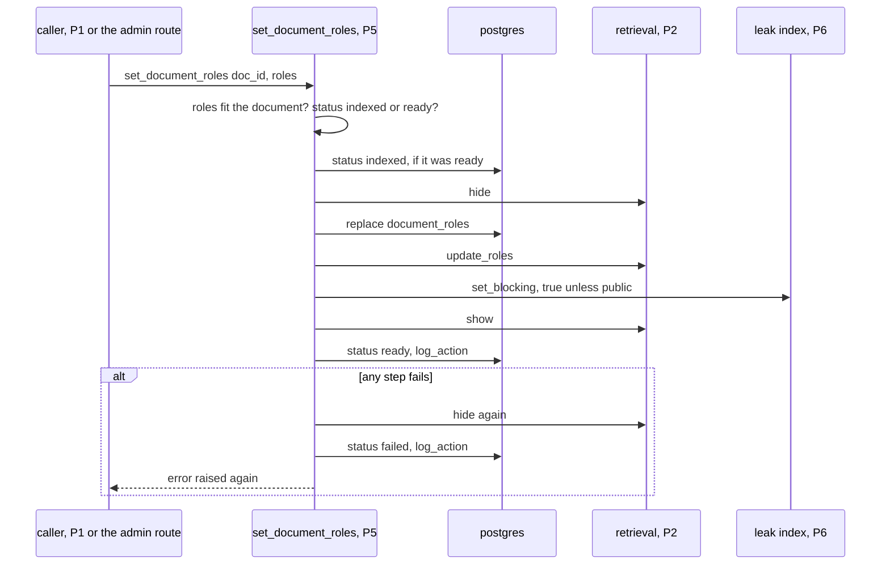
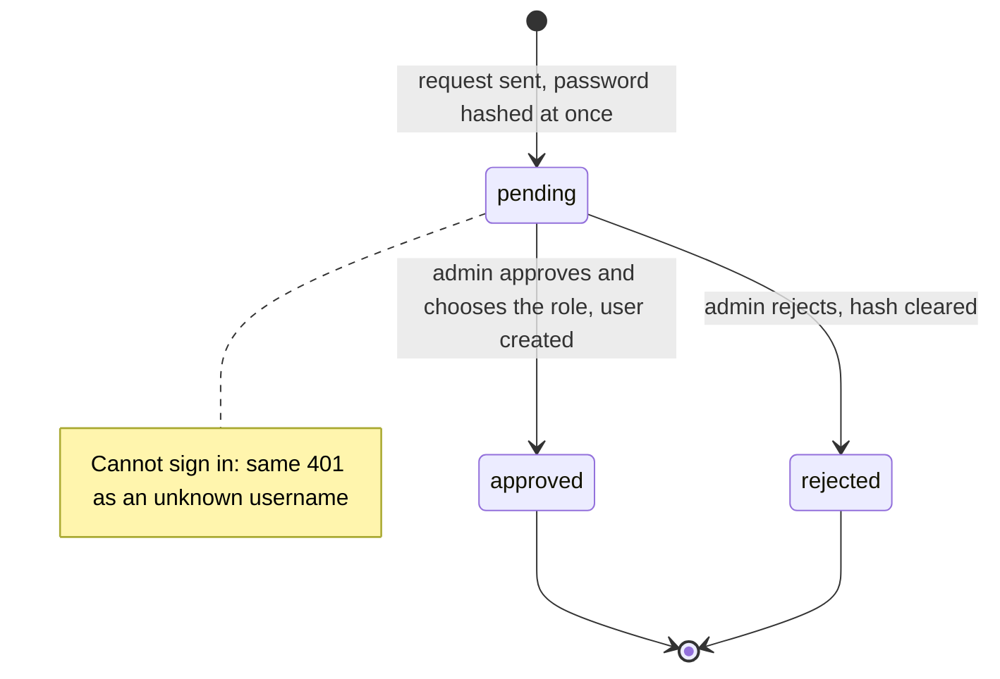

# P5 — Identity and access

> Status: **draft v0.1**. Read with [`../architecture.md`](../architecture.md) and [`00-shared.md`](00-shared.md). Names, types, IDs, errors and the signatures of every function shared with other parts are defined in `00-shared.md` and are not repeated here. The schema and classes below are P5's own design (architecture §9.1 and §12).

---

## 1. Purpose

Provide the **API backbone** every other part plugs into, and own **everything about access**: who the user is, what they can do, and which documents they can see. P5 doesn't filter search results itself (P2 does), but it guarantees that every request carries a reliable `UserContext`, it owns document rights and their publication, and it proves end to end that the access rules hold.

---

## 2. Owns / does not own

| P5 owns | Not P5 (owner) |
|---|---|
| The FastAPI app, middleware, error format, config and logging setup | The routes' business logic of `/search` (P2) and `/ask` (P3) |
| `registry.py` (all `get_*`) and the user fixtures in `tests/conftest.py` | Each part's fakes and real implementations (each part) |
| The PostgreSQL schema and every migration | Qdrant, BM25 (P2); the leak index (P6) |
| `AuthService`, `SecurityMiddleware`, `UserContext` | Filtering search results by role (P2) |
| Roles, users, document rights, publication (`set_document_roles`) | Processing document content (P1) |
| Document statuses (`set_status`) and the upload / status / delete routes | The leak filter (P6) |
| `AuditService` and the audit log | Login and admin screens (P7) |
| `AdminController` | Deciding whether a question needs the web (P3) |
| Original uploaded files | |
| Conversation history (`conversations`, `conversation_messages`) and its routes | The chat screens that use it (P7) |

Code: `src/api/main.py`, `src/api/deps.py`, `src/api/routes/{auth,documents,admin,conversations}.py`, `src/core/{config,logging,security,audit}.py`, `src/core/db/`, `src/core/contracts/registry.py`. Tests: `tests/access/`, `tests/e2e/`.

---

## 3. Requirements

MUST = required for validation. SHOULD = expected, can be cut if time runs out.

### 3.1 API skeleton (day 1)

- **P5-01** MUST create the FastAPI app in `src/api/main.py` with the routers of every part mounted: `/auth`, `/documents`, `/admin` (P5), `/search` (P2), `/ask` (P3). Each router file exists on day 1, even if it only returns a fake response.
- **P5-02** MUST add a middleware, running **before** authentication, that sets a `request_id` (UUID4, or the incoming `X-Request-ID` header if valid) for the request, stores it in a context variable, and returns it in the `X-Request-ID` response header.
- **P5-03** MUST provide `src/core/logging.py`: JSON logs on stdout, every line with `timestamp`, `level`, `request_id`, `event` and extra fields.
- **P5-04** MUST provide `src/core/config.py`: loads `.env` (secrets) and `config.yaml` (everything else) once, exposed as a typed `cfg` object (Pydantic settings). It refuses to start when `retrieval.top_k_final > retrieval.rerank_top_n`.
- **P5-05** MUST register one exception handler that turns any `AppError` into `{"code", "message"}` with its `http_status` (00-shared §7), and any other exception into `500 {"code": "internal_error"}` without details.
- **P5-06** MUST expose `GET /health` and allow no cross-origin requests (no CORS headers): the browser reaches the API only through the `ui` service, which forwards `/api/…` to `api:8000` (P7-01).
- **P5-07** MUST provide `src/core/contracts/registry.py` with every `get_*` function of 00-shared §9, each reading `cfg.contracts.<name>`, returning one cached instance per process, plus `override(name, instance)` and `reset()` for tests (00-shared §9).
- **P5-08** MUST provide the user fixtures in `tests/conftest.py`: `lecteur_ctx`, `editeur_ctx`, `admin_ctx`, `other_lecteur_ctx`, each with a **fixed** `user_id` written in the file (P1's sample chunks use `lecteur_ctx`'s as an owner).

### 3.2 Database

- **P5-09** MUST implement the eight tables of architecture §12 exactly (`roles`, `users`, `documents`, `document_roles`, `audit_log`, `account_requests`, `conversations`, `conversation_messages`) as SQLAlchemy models in `src/core/db/models.py`, with Alembic migrations in `src/core/db/migrations/`.
- **P5-09b** MUST connect to PostgreSQL with `cfg.database` (`host`, `port`, `name`, `user`) and `POSTGRES_PASSWORD` from `.env`. In CI, tests use `CI_POSTGRES_URL` instead.
- **P5-10** MUST be the only part that writes migrations. Another part needing a column asks P5.
- **P5-10b** MUST apply the migrations (`alembic upgrade head`) when `api` starts, before P5-12 and P5-12b and before serving any request, so a fresh `docker compose up` creates the tables. P5's tests apply them the same way on CI's database. `migrations/env.py` builds the database URL from `cfg.database` and `POSTGRES_PASSWORD` (P5-09b); `alembic.ini` holds no URL or password.
- **P5-11** MUST seed, in a migration, the three rows of `roles` (`admin`, `editeur`, `lecteur`) with a description and `web_enabled = true`.
- **P5-12** MUST create the first admin at startup from `ADMIN_USERNAME` / `ADMIN_PASSWORD` in `.env` if no admin exists.
- **P5-12b** MUST, at startup, set every document still `received`, `extracting` or `chunked` to `failed` with error `"interrupted"`: its background ingestion died with the previous process. The user can then delete it and upload it again.
- **P5-13** MUST fill the `documents` columns (architecture §12): `owner_id` (uploader for a private upload, else NULL), `status` (`received` at upload, then only through `set_status`), `error`, `file_hash` (at upload, `make_file_hash`), `content_hash` (through `set_content_hash`, called by P1), `date` (optional, as typed). The original file is stored at `storage/uploads/<doc_id><extension of source_file>`.

### 3.3 Authentication (`AuthService`, `src/core/security.py`)

- **P5-14** MUST hash passwords with Argon2 (`get_password_hash`, `verify_password`).
- **P5-15** MUST issue JWT access tokens (`create_access_token`) signed HS256 with `JWT_SECRET`, payload `{"sub": user_id, "exp": now + auth.token_minutes}`. No refresh token.
- **P5-16** MUST implement `POST /auth/login`: verify username and password, refuse inactive users, return `{access_token, token_type: "bearer"}`. Wrong username and wrong password return the **same** `401` message.
- **P5-16b** MUST implement `GET /auth/me` → `MeResponse` (00-shared §8): `web_available = cfg.web.enabled and roles.web_enabled` of the user's role, re-read on every call.
- **P5-17** MUST log every login, successful or not, with `log_action` (`AuditAction.LOGIN`, `details = {"success": bool}`), never the password.
- **P5-18** SHOULD limit failed logins to `auth.max_failed_logins` per username per `auth.lockout_minutes` (then `401` until the window passes).

### 3.4 `UserContext` and dependencies (`SecurityMiddleware`, `src/api/deps.py`)

- **P5-19** MUST implement `get_current_user_context(token) -> UserContext`: decode the token, then **re-read the user from the database** on every request (so a deactivated account or a role change takes effect immediately), set `web_enabled` from the role's `roles.web_enabled`, and attach the request's `request_id`.
- **P5-20** MUST accept only these document roles (00-shared §5.1): public `["lecteur", "editeur"]`, internal `["editeur"]`, private `[]`. `validate_roles` refuses (`InvalidInput`) any other list, including one containing `admin` or `lecteur` without `editeur`.
- **P5-21** MUST implement `require_roles(allowed_roles)`: a FastAPI dependency raising `Forbidden` if `ctx.role` is not in the list.
- **P5-22** MUST implement `record_audit_event(context, action)` as a thin wrapper over `AuditService.log_action`.
- **P5-23** MUST raise `Unauthenticated` for a missing, expired, malformed or unsigned token, and for a user that no longer exists or is inactive.

### 3.5 Documents and rights

- **P5-24** MUST implement `DocumentRights.create_document` (00-shared §6.1): check the format and the size (at most `uploads.max_bytes`, else `InvalidInput("file too large")`), compute `doc_id` with `make_doc_id`, refuse an existing `doc_id` with `Conflict`, save the file to `storage/uploads/<doc_id>.<ext>`, insert the `documents` row with status `received` (`source` and `date` trimmed, at most 500 characters), `log_action(DOCUMENT_UPLOAD)`. P1's command line calls it too.
- **P5-24b** MUST implement `POST /documents` (00-shared §8) as in §6.4 on top of `create_document` (scope = the uploader for a non-editor, `"corpus"` for an editor), return `202 {doc_id, status}`, and start `get_ingestion().ingest(doc_id, path, DocumentMeta(title, original file name, source, date), roles, owner_id)` as a background task. `roles` arrives as repeated form fields.
- **P5-25** MUST accept `roles` only from an `editeur`, who MUST give at least one. For any other user the document is private: `roles = []`, owner = the uploader.
- **P5-26** MUST implement `DocumentRights.set_document_roles` (00-shared §6.1) exactly as in §6.5: **hide → `document_roles` → P2 `update_roles` → P6 `set_blocking` → show → status `ready`**, and on any failure: document stays hidden, status `failed`, `log_action`, re-raise. The same function serves the first publication and every later change. It refuses (`InvalidInput`) a document whose status is not `indexed` or `ready`. A `failed` document is retried by deleting it and uploading it again (or by running P1's command line again).
- **P5-26b** MUST refuse roles that don't fit the document (00-shared §5.1): a private upload accepts only `[]`, a corpus document only the public or the internal list (`InvalidInput`). `PUT /admin/documents/{doc_id}/roles` answers `NotFound` for a private upload, so the admin can never publish it.
- **P5-27** MUST compute `blocking = not is_public(roles)` (`is_public(roles)` = `"lecteur" in roles`, in `src/core/security.py`). A private document (`roles = []`) is always blocking.
- **P5-28** MUST implement `set_status` with the transitions of 00-shared §3, raising `InvalidInput` on any other transition, plus `get_status` (00-shared §6.1).
- **P5-28b** MUST implement `set_content_hash(doc_id, content_hash)` (00-shared §6.1).
- **P5-29** MUST implement `GET /documents/{doc_id}/status` and `DELETE /documents/{doc_id}` (access: the uploader; for a corpus document, also `editeur` and `admin`; a private upload answers `NotFound` to anyone but its owner, the admin included). The status response has `duplicate_of`: the IDs of other documents with the same `content_hash` **in the same scope only** (other corpus documents for a corpus document, the same owner's uploads for a private one), `[]` otherwise, so it never reveals another user's document. Both answer `NotFound` (never `Forbidden`) to a user who may not see the document.
- **P5-29c** MUST implement `GET /documents` → `list[DocumentResponse]` (00-shared §8): the user's own private uploads for every user, plus all corpus documents for `editeur` and `admin`; never another user's private upload. Newest first.
- **P5-30** MUST delete in this order: P2 `hide` → P1 `delete` → remove the file → delete the `document_roles` and `documents` rows → `log_action(DOCUMENT_DELETE)`. The `documents` row is deleted **after** P1's `delete`, which reads it.
- **P5-30b** MUST refuse `DELETE` with `Conflict("document is being processed")` while the status is `received`, `extracting` or `chunked`, so a deletion never races with a running ingestion.

### 3.5b Conversation history (`src/api/routes/conversations.py`)

The chat history required by the PDF (F-UI-01). It is shown again to its owner; it is never sent to the agents.

- **P5-45** MUST implement the five `/conversations` routes of 00-shared §8. Each one only finds conversations whose `user_id` is `ctx.user_id`; any other `conversation_id` answers `NotFound`, exactly as an unknown one. `GET /conversations` lists the user's conversations, most recently updated first.
- **P5-46** MUST, on `POST /conversations/{id}/messages`: refuse an empty question or one longer than `agents.max_question_chars` (`InvalidInput`); store the question and the `Answer` as received; set `position` to the next number; set `cited_doc_ids` to the distinct non-null `doc_id`s of `answer.citations` (computed by P5, never sent by the client); set the conversation's `title` from the first question (cut to 60 characters) if it has none; update `updated_at`.
- **P5-47** MUST, on `GET /conversations/{id}`, check every exchange as in §6.8: `available` only if each cited document exists, is `ready`, and is visible to the user (owner, or `ctx.role` in its `document_roles`). Otherwise `answer = None`. The check reads P5's own tables; it never calls P2.
- **P5-48** MUST NOT store the thinking stream, passages or web queries, and MUST NOT offer any route that lets one user, the admin included, read another user's conversations.
- **P5-49** MUST delete a conversation's messages with it (`ON DELETE CASCADE`). Deleting a document does not touch conversations: the check of P5-47 hides the affected answers.

### 3.6 Administration (`AdminController`, `src/api/routes/admin.py`)

- **P5-31** MUST implement `create_user`, `update_user_role`, `set_document_roles`, `get_audit_trail`, `list_account_requests`, `approve_account_request`, `reject_account_request` and `set_role_web` behind the routes of 00-shared §8, all protected by `require_roles(["admin"])`.
- **P5-31b** MUST implement `set_role_web(role_id, web_enabled)` behind `PATCH /admin/roles/{role_id}/web`: update `roles.web_enabled`, return `{role_id, name, web_enabled}`. It takes effect on the next request of every user with that role (P5-19 re-reads it), without a restart.
- **P5-31c** MAY also let `editeur` change a document's roles after upload (`PUT /admin/documents/{doc_id}/roles`); this is P5's choice. If P5 allows it, it updates that route's role column in 00-shared §8 so P7 shows the action to `editeur` as well. The request and response stay the same either way.
- **P5-31e** MUST implement `PATCH /admin/users/{user_id}/active {is_active}` → `UserResponse`: a deactivated user gets `401` on their next request (P5-19). The admin cannot deactivate their own account (`InvalidInput`).
- **P5-31d** MUST implement `GET /admin/users` → `list[UserResponse]` and `GET /admin/roles` → `list[RoleResponse]` (00-shared §8), both `require_roles(["admin"])`. Reads are not logged.
- **P5-31f** MUST refuse (`InvalidInput`) to change the calling admin's own role, and to deactivate or demote the last active admin.
- **P5-32** MUST log every admin action with `log_action` (`AuditAction.ADMIN_UPDATE`, details: what changed, by IDs).
- **P5-33** MUST make `get_audit_trail(limit)` return the most recent entries first, `limit` capped at 1000.

### 3.6b Account requests (`src/api/routes/auth.py`, `src/api/routes/admin.py`)

Anyone can ask for an account; only the admin creates it. The admin keeps `create_user` for creating accounts directly.

- **P5-38** MUST implement `POST /auth/account-requests` (00-shared §8) as in §6.7: no token; validate `AccountRequestIn`; refuse with `Conflict("username not available")` a username that exists in `users` or in a `pending` request; hash the password with Argon2 **before** storing anything; insert an `account_requests` row with status `pending`; return `202 {request_id, status}`.
- **P5-39** MUST NOT store the plain password anywhere (table, log, audit, error), and MUST NOT return the hash in any response.
- **P5-40** MUST refuse new requests with `TooManyRequests` while the number of `pending` requests is `auth.max_pending_requests` or more.
- **P5-41** MUST implement `approve_account_request(request_id, role_id)` as in §6.7: only a `pending` request (else `InvalidInput`); check the username is still free in `users` (else `Conflict`, the request stays `pending`); create the user with the stored hash, the given role and `is_active = True`; set the request to `approved` with `decided_by` and `decided_at`; all in **one transaction**. The role is chosen by the admin, never by the requester.
- **P5-42** MUST implement `reject_account_request(request_id)`: only a `pending` request (else `InvalidInput`); set `rejected`, `decided_by`, `decided_at`, and clear `hashed_password`.
- **P5-43** MUST log approve and reject with `log_action` (`AuditAction.ADMIN_UPDATE`, details `{"account_request": id, "decision": ..., "role_id": ...}`).
- **P5-44** MUST answer `/auth/login` for a pending or rejected requester exactly as for an unknown username (`401`, same message, same timing as P5-16 and T20).

### 3.7 Audit (`AuditService`, `src/core/audit.py`)

- **P5-34** MUST implement `log_query(request_id, user_id, query, latency_ms)` and `log_action(user_id, action_type, details)`, writing to `audit_log` (`log_action` stores `details` in the `details` column). They are the only code that writes to `audit_log`. `log_action` accepts `user_id = None` (stored as `NULL`) for actions with no user: background jobs and logins with an unknown username. Both fill `audit_log.request_id` from the request's context variable (P5-02).
- **P5-35** MUST provide `audited_stream(ctx, question, events)` (00-shared §6.1) by **day 2**: it yields the events, adds `done` with `latency_ms` = time from the start of the request to the end of the stream, and calls `log_query` in a `finally` block. The `/ask` route is P3's; P3 wraps its stream with it.
- **P5-36** MUST NOT let a failed audit write fail the user's request: it is logged as an error and the request continues.
- **P5-37** MUST NOT store passwords, tokens or document text in `audit_log`.
- **P5-37b** decides how much of the question `audit_log.query_text` keeps (full, shortened, or nothing) and whether `/admin/audit` shows it to admins; this is P5's choice. The signature of `log_query` does not change. P5 defines the fields of `AuditLogResponse`, which P7 displays as they come.

---

## 4. Contracts provided

| What | Defined in | Used by |
|---|---|---|
| `UserContext` | 00-shared §5.1 | Everyone |
| `get_current_user_context`, `require_roles`, `record_audit_event` | 00-shared §6.1 | Every route |
| `DocumentRights` (`set_document_roles`, `set_status`, `get_status`, `set_content_hash`, `create_document`) | 00-shared §6.1 | P1 (`create_document`: its command line) |
| `Audit` (`log_query`, `log_action`) | 00-shared §6.1 | P1, P3, P6 |
| HTTP API (`/auth`, `/documents`, `/conversations`, `/admin`) | 00-shared §8 | P7 |
| `registry.py`, user fixtures, `cfg`, logging | this spec, §3.1 | Everyone |
| `FakeDocumentRights`, `FakeAudit` | 00-shared §9 | P1, P3, P6 |

## 5. Contracts consumed

| What | From | Used for |
|---|---|---|
| `Ingestion.ingest`, `Ingestion.delete` | P1 | Upload, delete |
| `Retrieval.update_roles`, `hide`, `show` | P2 | Publication, rights change, delete |
| `LeakIndex.set_blocking` | P6 | Publication, rights change |
| `make_doc_id` | 00-shared §4 | Upload |

---

## 6. Pseudocode

Every call to a function owned by **another part** is marked with its owner in a comment (`# P1`, `# P2`, `# P6`, `# shared`). Functions with no mark are written by P5.

### 6.1 Request ID middleware

```python
@app.middleware("http")
async def request_id_middleware(request, call_next):
    rid = valid_uuid(request.headers.get("X-Request-ID")) or uuid4()
    request_id_var.set(rid)
    response = await call_next(request)
    response.headers["X-Request-ID"] = str(rid)
    return response
```

### 6.2 `get_current_user_context`

```python
def get_current_user_context(
    token: str = Depends(oauth2_scheme), db=Depends(get_db)
) -> UserContext:
    try:
        payload = decode_access_token(token)  # checks signature and exp
        user_id = UUID(payload["sub"])
    except (JWTError, KeyError, ValueError):  # bad signature, expired, no/garbled "sub"
        raise Unauthenticated("invalid token")
    user = db.get(User, user_id)  # re-read on every request
    if user is None or not user.is_active:
        raise Unauthenticated("invalid token")
    role = user.role.name
    return UserContext(
        user_id=user.id,
        username=user.username,
        role=role,
        web_enabled=user.role.web_enabled,
        request_id=request_id_var.get(),
    )


def require_roles(allowed: list[str]):
    def dep(ctx: UserContext = Depends(get_current_user_context)) -> UserContext:
        if ctx.role not in allowed:
            raise Forbidden("forbidden")
        return ctx

    return dep
```

### 6.3 Login

```python
@router.post("/auth/login")
def login(body: LoginIn, db=Depends(get_db)):
    user = db.query(User).filter_by(username=body.username).one_or_none()
    hashed = user.hashed_password if user else DUMMY_HASH  # same Argon2 cost either way
    password_ok = verify_password(body.password, hashed)
    ok = user is not None and user.is_active and password_ok
    get_audit().log_action(user.id if user else None, LOGIN, {"success": ok})
    if not ok:
        raise Unauthenticated("wrong username or password")
    return {"access_token": create_access_token({"sub": str(user.id)}), "token_type": "bearer"}
```

### 6.4 Upload

```python
@router.post("/documents", status_code=202)
def upload(
    file: UploadFile,
    title: str = Form(...),
    source: str | None = Form(None),
    date: str | None = Form(None),
    roles: list[str] = Form([]),  # repeated fields
    ctx: UserContext = Depends(get_current_user_context),
    bg: BackgroundTasks = ...,
    db=Depends(get_db),
):
    is_editor = ctx.role == "editeur"
    owner_id = None if is_editor else ctx.user_id
    roles = validate_roles(roles, private=not is_editor) if is_editor else []
    if is_editor and not roles:
        raise InvalidInput("a corpus document needs at least one role")
    meta = DocumentMeta(
        title=title,
        source_file=file.filename,  # shared
        source=clean(source),
        date=clean(date),
    )  # trimmed, ≤ 500 chars
    doc_id, path = create_document(
        file.file.read(), file.filename, meta, owner_id, uploaded_by=ctx.user_id
    )
    bg.add_task(get_ingestion().ingest, doc_id, path, meta, roles, owner_id)  # P1
    return {"doc_id": doc_id, "status": "received"}


def create_document(data, file_name, meta, owner_id, uploaded_by) -> tuple[str, Path]:
    if suffix(file_name).lower() not in ALLOWED_SUFFIXES:  # same list as P1-06
        raise InvalidInput("unsupported format")
    if len(data) > cfg.uploads.max_bytes:
        raise InvalidInput("file too large")
    doc_id = make_doc_id(data, owner_id)  # shared
    if db.get(Document, doc_id):
        raise Conflict("already uploaded")
    path = save_file(f"storage/uploads/{doc_id}{suffix(file_name).lower()}", data)
    db.add(
        Document(
            id=doc_id,
            title=meta.title,
            source_file=file_name,
            source=meta.source,
            date=meta.date,
            owner_id=owner_id,
            status=RECEIVED,
            file_hash=make_file_hash(data),
            created_at=now(),
        )
    )  # shared
    db.commit()
    get_audit().log_action(uploaded_by, DOCUMENT_UPLOAD, {"doc_id": doc_id})
    return doc_id, path
```

### 6.5 `set_document_roles`



The document is hidden from before the first change until after the last one, so it is never visible to the wrong role, even for a moment.

```python
def set_document_roles(doc_id: str, roles: list[str]) -> dict:
    doc = get_document_or_404(doc_id)
    roles = validate_roles(
        roles, private=doc.owner_id is not None
    )  # InvalidInput if roles don't fit (P5-26b)
    if get_status(doc_id) not in (INDEXED, READY):
        raise InvalidInput(
            "document is not indexed"
        )  # a failed document is deleted and re-uploaded
    retrieval, leak = get_retrieval(), get_leak_index()  # P2, P6
    if get_status(doc_id) == READY:
        set_status(doc_id, INDEXED)  # first, so a failure below can go to FAILED
    try:
        retrieval.hide(doc_id)  # P2
        replace_document_roles(doc_id, roles)  # DB, one transaction
        retrieval.update_roles(doc_id, roles)  # P2
        leak.set_blocking(doc_id, blocking=not is_public(roles))  # P6
        retrieval.show(doc_id)  # P2
        set_status(doc_id, READY)
        get_audit().log_action(
            current_user_id_or_none(), ADMIN_UPDATE, {"doc_id": doc_id, "roles": roles}
        )
        return {"doc_id": doc_id, "status": READY}
    except Exception as e:
        safe(retrieval.hide, doc_id)  # make sure it stays hidden
        if get_status(doc_id) != FAILED:
            set_status(doc_id, FAILED, error=short_reason(e))
        get_audit().log_action(
            current_user_id_or_none(), ADMIN_UPDATE, {"doc_id": doc_id, "failed": short_reason(e)}
        )
        raise
```

`current_user_id_or_none()` is the admin's `user_id` when called from `PUT /admin/documents/{doc_id}/roles`, and `None` when called by P1's background ingestion. The `PUT` route itself first answers `NotFound` if `doc.owner_id` is set (P5-26b).

For a private document (`roles = []`), `show` makes it visible only to its owner: P2's visibility rule (00-shared §6.3) uses `owner_id`.

### 6.6 Delete

```python
@router.delete("/documents/{doc_id}", status_code=204)
def delete(doc_id: str, ctx=Depends(get_current_user_context)):
    doc = get_document_or_404(doc_id)
    corpus_manager = ctx.role in ("editeur", "admin") and doc.owner is None
    if not corpus_manager and doc.owner != ctx.user_id:
        raise NotFound("not found")  # never reveal existence
    if get_status(doc_id) in (RECEIVED, EXTRACTING, CHUNKED):
        raise Conflict("document is being processed")  # P5-30b
    get_retrieval().hide(doc_id)  # P2
    get_ingestion().delete(doc_id)  # P1 (reads the documents row)
    remove_file(doc)
    delete_rows(doc_id)  # document_roles, then documents
    get_audit().log_action(ctx.user_id, DOCUMENT_DELETE, {"doc_id": doc_id})
```

### 6.7 Account requests




```python
@router.post("/auth/account-requests", status_code=202)
def request_account(body: AccountRequestIn, db=Depends(get_db)):  # no token
    validate_account_request(body)  # username pattern, password length, full_name length
    if count_pending_requests(db) >= cfg.auth.max_pending_requests:
        raise TooManyRequests("too many pending requests, try later")
    if username_taken(db, body.username):  # in users, or in a pending request
        raise Conflict("username not available")
    req = AccountRequest(
        id=uuid4(),
        username=body.username,
        hashed_password=get_password_hash(body.password),  # hashed before storing
        full_name=body.full_name,
        status=PENDING,
        created_at=now(),
    )
    db.add(req)
    db.commit()
    return {"request_id": req.id, "status": PENDING}


@router.post("/admin/account-requests/{request_id}/approve")
def approve_account_request(
    request_id: UUID, body: ApproveIn, ctx=Depends(require_roles(["admin"])), db=Depends(get_db)
):
    with db.begin():  # one transaction
        req = get_request_or_404(db, request_id, for_update=True)
        if req.status != PENDING:
            raise InvalidInput("request already decided")
        role = get_role_or_422(db, body.role_id)
        if db.query(User).filter_by(username=req.username).first():
            raise Conflict("username not available")  # request stays pending
        user = User(
            id=uuid4(),
            username=req.username,
            hashed_password=req.hashed_password,
            full_name=req.full_name,
            role_id=role.id,
            is_active=True,
            created_at=now(),
        )
        db.add(user)
        req.status, req.decided_by, req.decided_at = APPROVED, ctx.user_id, now()
    get_audit().log_action(
        ctx.user_id,
        ADMIN_UPDATE,
        {"account_request": str(request_id), "decision": "approved", "role_id": role.id},
    )
    return UserResponse.from_orm(user)


@router.post("/admin/account-requests/{request_id}/reject", status_code=204)
def reject_account_request(
    request_id: UUID, ctx=Depends(require_roles(["admin"])), db=Depends(get_db)
):
    with db.begin():
        req = get_request_or_404(db, request_id, for_update=True)
        if req.status != PENDING:
            raise InvalidInput("request already decided")
        req.status, req.decided_by, req.decided_at = REJECTED, ctx.user_id, now()
        req.hashed_password = None  # no longer needed
    get_audit().log_action(
        ctx.user_id, ADMIN_UPDATE, {"account_request": str(request_id), "decision": "rejected"}
    )
```

`/auth/login` (§6.3) reads only `users`, so a pending or rejected requester is treated as an unknown username with no extra code.

### 6.8 Opening a conversation

```python
@router.get("/conversations/{conversation_id}")
def open_conversation(conversation_id: UUID, ctx=Depends(get_current_user_context)):
    conv = db.get(Conversation, conversation_id)
    if conv is None or conv.user_id != ctx.user_id:
        raise NotFound("not found")  # same for missing and not yours
    visible = visible_doc_ids(ctx, all_cited_ids(conv))  # one query on documents + document_roles
    out = []
    for m in conv.messages:  # by position
        ok = all(d in visible for d in m.cited_doc_ids)
        out.append(
            MessageResponse(
                position=m.position,
                question=m.question,
                available=ok,
                answer=m.answer if ok else None,
                language=m.answer["language"],
                created_at=m.created_at,
            )
        )
    return ConversationDetail(..., messages=out)


def visible_doc_ids(ctx, doc_ids) -> set[str]:
    # documents that exist, are ready, and that this user may see
    return {
        d.id
        for d in documents_with_ids(doc_ids)
        if d.status == "ready" and (d.owner_id == ctx.user_id or ctx.role in roles_of(d))
    }
```

A deleted document is simply absent from `visible`, so its answers become unavailable exactly like a restricted one.

---

## 7. Error handling

| Situation | What P5 does |
|---|---|
| Missing, expired or invalid token | `401 Unauthenticated` |
| Deactivated or deleted user with a valid token | `401 Unauthenticated` on the next request |
| Role not allowed on a route | `403 Forbidden` |
| Document the user may not see | `404 NotFound`, same message as a missing document |
| Another user's conversation | `404 NotFound`, same message as a missing conversation |
| Saved exchange whose cited document is no longer visible | `available = false`, `answer = None` (P5-47) |
| Same file uploaded twice in the same scope | `409 Conflict` |
| Unknown role in `roles` | `422 InvalidInput` |
| Editor uploads with no role | `422 InvalidInput` |
| `set_document_roles` on a document not `indexed` or `ready` | `422 InvalidInput` |
| Delete while ingestion is running | `409 Conflict` |
| Any step of `set_document_roles` fails | Document hidden, `failed`, audited, error re-raised |
| P1's background ingestion fails | P1 sets `failed`; P5 does nothing more |
| Account request with a taken username | `409 Conflict("username not available")` |
| Account request when `auth.max_pending_requests` are pending | `429 TooManyRequests` |
| Approve or reject a request already decided | `422 InvalidInput` |
| Approve when the username was taken in the meantime | `409 Conflict`, request stays `pending` |
| Audit write fails | Logged as an error, request continues |
| Any unexpected exception | `500 {"code": "internal_error"}`, no details in the response |

**Do NOT:**
- trust a role or user ID sent by the client; only the token and the database count;
- build a `UserContext` anywhere except `get_current_user_context` (and the test fixtures);
- answer `403` for a document the user may not see;
- show a document before its rights, P2 and P6 are all updated;
- put a password, a token or document text in a log, an error or the audit log;
- let another part write to PostgreSQL directly.

---

## 8. Acceptance tests

Each one becomes a pytest in `tests/access/` or `tests/e2e/`, through HTTP (FastAPI `TestClient`).

| # | Given | When | Then |
|---|---|---|---|
| T1 | No token | Any route except `/auth/login`, `/auth/account-requests`, `/health` | `401` |
| T2 | An expired or tampered token | Any route | `401` |
| T3 | A user deactivated after login | Next request with the same token | `401` |
| T4 | A user whose role is changed by an admin | Next request | New role applies |
| T5 | Wrong password, and unknown username | `/auth/login` | Same `401` message; both audited |
| T6 | A `lecteur` | Any `/admin/...` route | `403` |
| T7 | An internal document (`["editeur"]`) | `editeur`, `lecteur` and `admin` ask a question about it via `/search` and `/ask` | `editeur` gets it; `lecteur` and `admin` get no chunk, title or hint of it **(mandatory test a)** |
| T8 | Citizen A's private upload | Citizen B searches its content; B calls its status and delete routes | Nothing returned; `404` on both routes |
| T9 | A `ready` document | Rights changed from `["editeur"]` to `["lecteur", "editeur"]` (internal → public), then back | `lecteur` sees it right after the first change, not after the second; `editeur` sees it throughout |
| T10 | P2 `update_roles` raises during `set_document_roles` | — | Status `failed`; no user can find the document |
| T11 | Same file uploaded twice by the same editor | Second upload | `409` |
| T12 | Same file uploaded by two citizens | Both uploads | Two different `doc_id`s, both `202` |
| T13 | A `lecteur` uploads with `roles = ["editeur"]` | Upload | `roles` ignored, document private to them |
| T14 | `set_status` from `received` to `ready` | — | `InvalidInput` |
| T15 | Any request | Response | `X-Request-ID` header present; same ID in the log lines and the audit entry |
| T16 | Every test above | Inspect `audit_log` and logs | No password, token or document text |
| T17 | A document deleted | Search for it; call P1 cleanup | Gone from search; P1 `delete` was called before the row was removed |
| T18 | A document still `extracting` | `DELETE` | `409` |
| T19 | A `failed` document | `set_document_roles` | `422`; status unchanged |
| T20 | Unknown username vs known username with wrong password | Time 20 logins of each | No measurable difference |
| T21 | No token | `POST /auth/account-requests` with valid data | `202`, row `pending`, `hashed_password` is an Argon2 hash, the plain password appears nowhere in the DB or logs |
| T22 | A pending request for `"sara"` | Login as `"sara"` with the requested password | Same `401` as an unknown username |
| T23 | A pending request | Admin approves with the `lecteur` role | `UserResponse` with role `lecteur`; login with the requested password works; request `approved`, `decided_by` = admin |
| T24 | A pending request | Admin rejects it | `204`; login fails; request `rejected`, `hashed_password` empty |
| T25 | Username `"sara"` exists in `users`, or in a pending request | New request for `"sara"` | `409` |
| T26 | A pending request for `"x"`, then the admin creates a user `"x"` directly with `create_user` | Approve the request | `409`; request still `pending` |
| T27 | A `lecteur` or `editeur` | Any `/admin/account-requests` route | `403` |
| T28 | `max_pending_requests` pending requests | One more request | `429` |
| T29 | An approved or rejected request | Approve or reject it again | `422` |
| T30 | Any account request route | Inspect every response | No password and no hash |
| T31 | Admin sets `web_enabled = false` for `lecteur` | Next request of a logged-in `lecteur` | `ctx.web_enabled == false`, no restart needed; `editeur` unaffected |
| T32 | A `lecteur` or `editeur` | `PATCH /admin/roles/{id}/web` | `403` |
| T33 | A digital PDF and a scan of the same text, both uploaded by an editor | Status of the second | `duplicate_of` = [first doc_id] |
| T34 | Citizen A and citizen B upload files with the same text | Status of B's document | `duplicate_of = []` |
| T35 | A `lecteur` with one private upload, another `lecteur` with one, corpus documents | `GET /documents` as the first `lecteur` | Only their own upload |
| T36 | Same | `GET /documents` as `editeur` and as `admin` | All corpus documents (+ their own uploads); no `lecteur` upload |
| T37 | `web.enabled = false` in config, or `roles.web_enabled = false` for the user's role | `GET /auth/me` | `web_available = false` |
| T38 | A `lecteur` or `editeur` | `GET /admin/users`, `GET /admin/roles` | `403` |
| T39 | The end-to-end test of architecture §15 (`tests/e2e/`) | — | Passes with every contract `real` |
| T40 | A citizen's private upload; a corpus document | Admin `PUT …/roles` with `["lecteur", "editeur"]` on the first; `[]` on the second | `404`; `422`; nothing changed |
| T41 | A user | Admin sets `is_active = false`, then the user calls any route | `401` |
| T42 | A file larger than `uploads.max_bytes` | Upload | `422`, nothing stored |
| T43 | `retrieval.hide` raising during a rights change on a `ready` document | `PUT …/roles` | `503`; status `failed`; failure audited |
| T44 | Any `log_action` during a request | Inspect `audit_log` | `request_id` = the request's `X-Request-ID` |
| T45 | A document left `extracting` when the API stopped | API restarts | Status `failed`, error `"interrupted"`; it can be deleted |
| T46 | One active admin | They change their own role, or deactivate themselves | `422`; nothing changed |
| T47 | A corpus document; a citizen's private upload | Admin `DELETE` on each | `204`, deletion done and audited; `404` on the upload, nothing changed |
| T48 | User A's conversation | User B (any role, admin included) calls `GET`, `POST …/messages`, `DELETE` on it | `404` each time; nothing changed |
| T49 | An empty conversation | Post two exchanges, then open it | `position` 1 and 2; `title` = first question (≤ 60 characters); `updated_at` changed; `cited_doc_ids` stored from the citations |
| T50 | A `lecteur`'s saved answer citing a public document | Admin sets the document to internal, then the `lecteur` opens the conversation | That exchange: `available = false`, `answer = None`, question kept; the others unchanged |
| T51 | Same, but the document is deleted; and a posted answer citing a `doc_id` that does not exist | Open the conversation | Both: `available = false`, identical responses |
| T52 | A saved `unknown` answer and a web-only answer | Any document change, then open | Both still available |
| T53 | Two users with conversations | `GET /conversations` as each | Only their own, most recently updated first |

Contract tests in `tests/contracts/` run on fake and real: `DocumentRights` (T10, T14, publication order), `Audit` (an entry is written, T16).

---

## 9. Minimum version vs full version

| Minimum (must work for validation) | Full |
|---|---|
| Skeleton, middleware, error handler, config, logging, registry, fixtures | — |
| The eight tables + migrations, roles seeded, first admin | — |
| Login, Argon2, JWT, `get_current_user_context` re-reading the DB, `require_roles` | + login rate limit |
| `create_document`, upload, status, delete, `GET /documents`, `GET /auth/me`, `set_document_roles` with the full sequence and the ownership check | + `uploads.max_bytes` |
| `create_user`, `update_user_role`, `set_user_active`, `get_audit_trail`, `GET /admin/users`, `GET /admin/roles` | + filters on the audit trail |
| Account requests: request, list, approve, reject | + `max_pending_requests` cap |
| `log_query`, `log_action` | — |
| Conversation history: two tables, five routes, owner-only access, the check on read | — |
| T1, T3, T6, T7, T8, T9, T10, T13, T21–T24 | All tests |

---

## 10. Schedule

Day 0 is for reading; building starts on day 1. The whole team's plan is in `../schedule.md`; the **checkpoints** are what this part must have merged by the end of that day.

| Day | Date | Delivered |
|---|---|---|
| 0 | Mon 11-09 | Read the docs; prepare the skeleton and the first six tables |
| 1 | Tue 11-10 | **Checkpoint:** skeleton with every router mounted, middleware, error handler, `cfg`, logging, `registry.py`, user fixtures, `FakeDocumentRights`, `FakeAudit` + contract tests |
| 2 | Wed 11-11 | **Checkpoint:** the first six tables (the two conversation tables come on day 4) + migrations, roles seeded, first admin; login and `get_current_user_context` working; `audited_stream` merged |
| 3 | Thu 11-12 | `create_document`, upload, status, delete (admin included for corpus documents), `GET /documents`, `/auth/me` |
| 4 | Fri 11-13 | `set_document_roles`, admin routes, account requests, startup cleanup; conversation tables (migration) and routes |
| 5 | Sat 11-14 | **Checkpoint:** upload, status, delete, `set_document_roles` against fakes of P1, P2, P6; admin routes including account requests; `/auth/me`, `GET /documents`, `GET /admin/users`, `GET /admin/roles`; conversation routes; T1–T6, T11–T15, T21–T30, T35–T38, T40–T53 green |
| 6 | Sun 11-15 | With P1 and P2: upload → ingestion → publication on the real parts |
| 7 | Mon 11-16 | With P6: real `set_blocking`; end-to-end test (T39) written |
| 8 | Tue 11-17 | **Checkpoint:** against the real P1, P2, P6: T7–T10, T17, T39 green (mandatory test a, end-to-end test); all tests green |
| 9 | Wed 11-18 | **Feature freeze.** Read the first evaluation results; list this part's problems |
| 10 | Thu 11-19 | Tune this part's values (schedule.md §3) and fix bugs · Demo accounts and roles created on the demo machine |
| 11 | Fri 11-20 | Tuning and fixes; second evaluation run; **report section** on this part drafted (French) |
| 12 | Sat 11-21 | Fixes only, each tested on the demo machine; **demo rehearsal 1** |
| 13 | Sun 11-22 | **Demo rehearsal 2** (morning); submission |
