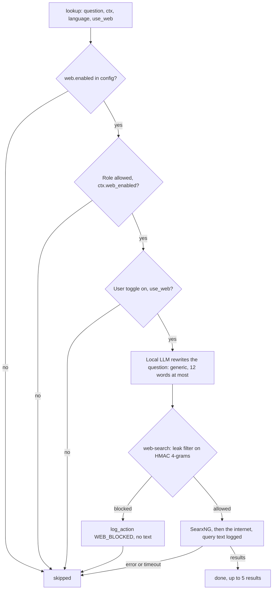

# P6 — Sovereignty and web isolation

> Status: **draft v0.1**. Read with [`../architecture.md`](../architecture.md) and [`00-shared.md`](00-shared.md). Names, types, IDs, errors and the signatures of every function shared with other parts are defined in `00-shared.md` and are not repeated here.

---

## 1. Purpose

Everything runs **locally**, in one `docker compose`, with **one controlled exit to the internet**, and nothing from the internal corpus can leave through it. P6 also serves the models (LLM, embeddings, re-ranker, OCR) that every other part uses.

---

## 2. Owns / does not own

| P6 owns | Not P6 (owner) |
|---|---|
| `docker-compose.yml`, networks, profiles, `Makefile` | The application code inside `api` and `ui` (each part) |
| Serving the LLMs, embeddings, re-ranker and OCR engine offline | Choosing the OCR engine, cleaning OCR output (P1) |
| `LLMClient`, `OCRClient`, `ModelsClient` and their implementations | Using embeddings to index and search (P2) |
| The web agent: generic reformulation, switch check, calling `web-search` | Deciding *when* the web is needed (P3) |
| The `web-search` container, the only service with internet | Which documents are public, internal or private (P5) |
| The leak index and leak filter | What the narration says (P4) |
| Network isolation and offline tests | Storing the web switches (P5) |

Code: `src/core/llm/`, `src/agents/web/`, `src/core/leak/`, `services/web-search/`, `services/models/`, `docker-compose.yml`, `Makefile`. Tests: `tests/sovereignty/`.

---

## 3. Requirements

MUST = required for validation. SHOULD = expected, can be cut if time runs out.

### 3.1 Infrastructure

- **P6-01** MUST provide `docker-compose.yml` with the services of architecture §5: `api`, `ui`, `postgres`, `qdrant`, `llm` (Ollama), `models`, `ocr`, `web-search`, `searxng`, and `cloud-gateway` (profile `cloud` only). `config.yaml` is mounted read-only into `api`, `ui` and `web-search`.
- **P6-01b** MUST configure the `postgres` service so it creates the database `database.name` owned by `database.user` (`POSTGRES_DB`, `POSTGRES_USER` from those `config.yaml` values, `POSTGRES_PASSWORD` from `.env`), on the `internal` network only, with its data in the volume `pg_data`.
- **P6-01c** MUST give `api` the named volumes `uploads` (`storage/uploads`), `extract_cache` (`cache/extracted`) and `indexes` (`data/indexes`), and mount `data/raw` read-only, so uploads, the extraction cache and the corpus survive a rebuild.
- **P6-02** MUST declare three networks: `internal` with `internal: true`; `front`, a bridge with IP masquerade turned off (`com.docker.network.bridge.enable_ip_masquerade: "false"`), reachable from the host but with no route to the internet; and `egress`. `api` and `ui` are on `internal` + `front` and publish their ports there. Only `web-search`, `searxng` and `cloud-gateway` are attached to `egress`. Every other service is on `internal` only. Checked on day 2.
- **P6-03** MUST provide the profiles `local` (default), `light` and `cloud`, selected by `mode` in `config.yaml` and the matching compose profile.
- **P6-04** MUST provide `make models`, which downloads every model (LLMs, the Qwen tokenizer files, bge-m3, bge-reranker-v2-m3, OCR model) into Docker volumes. After it has run once, `docker compose up` MUST work with no internet access.
- **P6-05** MUST provide `make up`, `make up-light`, `make down`, `make test-isolation`, and `make seed` (runs P1's `seed` inside `api`, P1-33). Each target is one line in the `Makefile` and is documented in `README.md`.
- **P6-06** SHOULD give every service a health check, and make `api` wait for `postgres`, `qdrant`, `llm` and `models` to be healthy.
- **P6-07** SHOULD measure RAM, GPU use and latency of `local` and `light`, and of the narration model at 1.5B and 0.5B, on the demo machine, plus the end-to-end time of a simple question (target: under 10 s on average), and write the results in `docs/hardware.md`. The narration model starts at `qwen2.5:1.5b`; if it slows the answer down on the demo machine, P6 switches `llm.narration_model` to `qwen2.5:0.5b` (a config change only).

### 3.2 Model serving

- **P6-08** MUST serve through Ollama (`llm` service): the main model (`llm.model`, Qwen 2.5 7B), the light model (`llm.model_light`, 3B) and the narration model (`llm.narration_model`, 0.5B–1.5B). `OllamaClient` passes `llm.num_ctx` as `options.num_ctx` on every call: Ollama's default context is too small for the Rédacteur's prompt and would cut it silently.
- **P6-09** MUST serve bge-m3 embeddings and bge-reranker-v2-m3 from the `models` service over HTTP (§4.2). Both always run locally, in every mode.
- **P6-10** MUST serve OCR from the `ocr` service over HTTP (§4.3): Tesseract with the `ara` model from day 2, then the engine P1 chooses from its benchmark (day 5) if it differs.

### 3.3 Clients (`src/core/llm/`)

- **P6-11** MUST implement `LLMClient` (00-shared §6.4) as `OllamaClient`, `GatewayClient` and `FakeLLMClient`. `FakeLLMClient` MUST be merged on day 1.
- **P6-12** MUST implement `OCRClient` as `HttpOCRClient` (the `ocr` service) and `FakeOCRClient`. SHOULD add `GatewayOCRClient` (cloud fallback, `cloud` mode only).
- **P6-13** MUST implement `ModelsClient` (00-shared §6.4) as `HttpModelsClient` and `FakeModelsClient`.
- **P6-14** MUST make `GatewayClient` and `GatewayOCRClient` refuse to be created unless `mode == "cloud"` **and** `ALLOW_CLOUD_LLM=true` in `.env`, raising `ServiceError("cloud mode not allowed")`.
- **P6-15** MUST set `temperature = 0.0` by default and respect `max_tokens` in every implementation.
- **P6-16** MUST make `count_tokens` use the tokenizer of the model in use (the Qwen tokenizer files downloaded by `make models`, loaded with the `tokenizers` library), not a word count, except in `FakeLLMClient`.

### 3.4 Web agent (`src/agents/web/`)

- **P6-17** MUST implement `WebAgent.lookup(question, ctx, language, use_web)` (00-shared §6.4) exactly as in §6.4 below.
- **P6-18** MUST check the three switches before anything else: `web.enabled` (config, global), `ctx.web_enabled` (the user's role, set by the admin, stored in `roles` by P5) and `use_web` (the user's choice for this question). If any is off, return `WebLookup(status="skipped", results=[])` without calling the LLM or the network.
- **P6-19** MUST build the web query with the local LLM through `get_llm()`, from the **question only**. The reformulation prompt (§6.4) removes names, places, numbers of documents, dates and personal details, and limits the query to `web.max_query_words` words. Never pass passages, titles or any metadata of corpus documents to the web agent.
- **P6-20** MUST treat `LeakBlocked`, `ServiceError` and a timeout of `web.timeout_s` the same way for the caller: `WebLookup(status="skipped", results=[])`. The caller never learns why. The real `WebSearch` maps `403 leak_blocked` to `LeakBlocked(hits)` and every other failure (`403 web_disabled`, 5xx, connection error, timeout) to `ServiceError`; `lookup` ends with a catch-all that also returns `skipped`, so it never raises.
- **P6-21** MUST log a blocked query with `log_action(ctx.user_id, WEB_BLOCKED, {"request_id": …, "hits": n})`, never the query text.
- **P6-22** MUST cap results at `web.max_results` and truncate each `snippet` to `web.max_snippet_chars`.

### 3.5 `web-search` container (`services/web-search/`)

- **P6-23** MUST expose `POST /search {query, max_results, request_id}` → `{results: [{url, title, snippet}]}` and `POST /index`, `POST /blocking`, `DELETE /index/{doc_id}` for the leak index (§4.4). No other endpoint.
- **P6-24** MUST run the leak filter (§6.6) on **every** `/search` query **before** contacting SearxNG. A blocked query returns `403 {"code": "leak_blocked", "hits": n}` and is never sent out.
- **P6-25** MUST refuse every `/search` with `403 {"code": "web_disabled"}` when `web.enabled` is false (read from the mounted `config.yaml`).
- **P6-26** MUST forward allowed queries to the `searxng` service and return only `url`, `title`, `snippet`.
- **P6-27** MUST log one line per `/search` with `request_id`, status (`ok | blocked | disabled | error`), number of hits and latency. For an **allowed** query (`ok`), the line also holds the query text: it has already gone to the search engine, and the log lets the team and the jury review every query that left the system. A **blocked** query's text is never logged anywhere.
- **P6-28** MUST require the shared token (`LEAK_API_TOKEN` in `.env`) on every endpoint, `/search` included, and accept calls only from the `internal` network. Only `api` holds the token, so no other container can send a web query around the switches.

### 3.6 Leak index (`src/core/leak/` + storage in `web-search`)

- **P6-29** MUST compute fingerprints **inside `api`** (`src/core/leak/fingerprint.py`), so only hashes ever reach `web-search`:
  1. `tokens = normalize_ar(text).split()` (P1's function);
  2. 4-grams of consecutive tokens (`leak.ngram`);
  3. each 4-gram → `HMAC-SHA256(LEAK_HMAC_KEY, " ".join(gram))`, first 16 hex characters.
- **P6-30** SHOULD also fingerprint **references** in the text: matches of `(رقم|عدد)((?: \d+)+)` found in the **normalized** text, e.g. `دورية رقم 12/2025` → normalized `رقم 12 2025` (normalization turns `١٢` into `12` and `/` into a space), stored with a `ref:` prefix before hashing.
- **P6-31** MUST implement `LeakIndex` (00-shared §6.4): `register` stores the document's fingerprints with `blocking = True`; `set_blocking` changes the flag; `delete` removes the document's fingerprints. All three are idempotent.
- **P6-32** MUST store, per fingerprint, the set of `doc_id`s that contain it and whether each one is blocking, in a file-backed store (SQLite) on the volume `leak_data` of `web-search`, so the index survives a restart: an empty index would let every query through.
- **P6-33** MUST count a fingerprint as a **hit** only if it belongs to at least one blocking document **and** to no non-blocking (public) document, and SHOULD also require that it appears in fewer than `leak.max_df` documents. Phrases found in public law (or in many documents) never block.
- **P6-34** MUST block a query if `hits >= leak.min_hits` **or** `hits / number_of_query_4grams >= leak.overlap_threshold`, **or** it contains any reference hit.
- **P6-35** MUST read `LEAK_HMAC_KEY` from `.env`, shared by `api` and `web-search`, and never committed.

---

## 4. Contracts provided

| What | Defined in | Used by |
|---|---|---|
| `LLMClient` (+ `FakeLLMClient`, day 1) | 00-shared §6.4 | P3, P4, P6 web agent |
| `OCRClient` | 00-shared §6.4 | P1 |
| `ModelsClient` (embed, rerank) | 00-shared §6.4 | P2 |
| `LeakIndex` | 00-shared §6.4 | P1 (`register`, `delete`), P5 (`set_blocking`) |
| `WebAgent.lookup` | 00-shared §6.4 | P3 |
| `docker-compose.yml`, `make` targets | this spec, §3.1 | Everyone |

### 4.1 Internal HTTP APIs (inside the compose network)

These are called only by P6's own clients. Other parts use the Python clients above, never the HTTP APIs directly.

### 4.2 `models` service

| Method | Path | Body | Response |
|---|---|---|---|
| POST | `/embed` | `{"texts": [str]}` | `{"vectors": [[float × 1024]]}` |
| POST | `/rerank` | `{"query": str, "texts": [str]}` | `{"scores": [float]}` (same order as `texts`) |
| GET | `/health` | — | `200` |

### 4.3 `ocr` service

| Method | Path | Body | Response |
|---|---|---|---|
| POST | `/ocr` | multipart: `image`, `lang` | `{"text": str, "confidence": float}` |
| GET | `/health` | — | `200` |

### 4.4 `web-search` service

| Method | Path | Body | Response |
|---|---|---|---|
| POST | `/search` | `{"query": str, "max_results": int, "request_id": str}` | `{"results": [...]}` · `401` (no token) · `403 leak_blocked` · `403 web_disabled` · `503` |
| POST | `/index` | `{"doc_id": str, "grams": [str], "refs": [str]}` | `204` |
| POST | `/blocking` | `{"doc_id": str, "blocking": bool}` | `204` |
| DELETE | `/index/{doc_id}` | — | `204` |
| GET | `/health` | — | `200` |

## 5. Contracts consumed

| What | From | Used for |
|---|---|---|
| `normalize_ar` | P1 | Fingerprints |
| `Audit.log_action` | P5 | Logging blocked web queries |
| `UserContext` | P5 | Switch check in the web agent |
| Web switches: `web.enabled` (`config.yaml`), `ctx.web_enabled` (`UserContext`, from `roles.web_enabled`), `use_web` (from `/ask` through P3) | P5, P3 | Switch check |

---

## 6. Pseudocode

Every call to a function owned by **another part** is marked with its owner in a comment (`# P1`, `# P5`, `# shared`). Functions with no mark are written by P6.

### 6.1 Cloud guard

```python
class GatewayClient(LLMClient):
    def __init__(self):
        if cfg.mode != "cloud" or os.environ.get("ALLOW_CLOUD_LLM") != "true":
            raise ServiceError("cloud mode not allowed")          # shared error
        self.url = "http://cloud-gateway:8000"
```

### 6.2 `real_llm` (called by `get_llm` in `registry.py` when `contracts.llm` is `real`)

```python
def real_llm() -> LLMClient:
    if cfg.mode == "cloud":
        return GatewayClient()                    # raises if not allowed
    model = cfg.llm.model_light if cfg.mode == "light" else cfg.llm.model
    return OllamaClient(cfg.llm.base_url, model)
```

### 6.3 Leak index (in `api`)

```python
def fingerprints(text: str) -> tuple[list[str], list[str]]:
    norm   = normalize_ar(text)                                            # P1
    tokens = norm.split()
    grams  = [" ".join(tokens[i:i + N]) for i in range(len(tokens) - N + 1)]
    refs   = ["ref:" + m.group(0) for m in re.finditer(r"(رقم|عدد)((?: \d+)+)", norm)]
    return sorted({hmac16(g) for g in grams}), sorted({hmac16(r) for r in refs})

def hmac16(s: str) -> str:
    return hmac.new(LEAK_HMAC_KEY, s.encode(), "sha256").hexdigest()[:16]

AUTH = {"Authorization": f"Bearer {LEAK_API_TOKEN}"}          # P6-28

class HttpLeakIndex(LeakIndex):
    def register(self, doc_id, text):
        grams, refs = fingerprints(text)
        post(WEB_SEARCH + "/index", {"doc_id": doc_id, "grams": grams, "refs": refs}, headers=AUTH)
        # web-search stores them with blocking = True
    def set_blocking(self, doc_id, blocking):
        post(WEB_SEARCH + "/blocking", {"doc_id": doc_id, "blocking": blocking}, headers=AUTH)
    def delete(self, doc_id):
        http_delete(WEB_SEARCH + f"/index/{doc_id}", headers=AUTH)
```

### 6.4 Web agent



Every `skipped` looks the same to the caller: it never learns which check stopped the query. The networks are drawn in architecture §5.

```python
REFORMULATE_PROMPT = """Rewrite the user's question as a short web search query, in {language}.
Rules: at most {max_words} words; keep only the general legal topic;
remove names of people, organisations, places, document numbers, dates and figures;
answer with the query only."""

def lookup(question: str, ctx: UserContext, language: str, use_web: bool = True) -> WebLookup:
    if not (cfg.web.enabled and ctx.web_enabled and use_web):
        return WebLookup(status="skipped", results=[])

    try:
        query = get_llm().chat([
            {"role": "system", "content": REFORMULATE_PROMPT.format(
                language=LANGUAGE_NAMES[language],          # "Modern Standard Arabic" | "French"
                max_words=cfg.web.max_query_words)},
            {"role": "user", "content": question},
        ], max_tokens=40)
        query = " ".join(query.split()[:cfg.web.max_query_words])   # enforce the limit
        if not query:
            return WebLookup(status="skipped", results=[])
        results = get_web_search().search(query, cfg.web.max_results,
                                          request_id=ctx.request_id)
    except LeakBlocked as e:
        get_audit().log_action(ctx.user_id, WEB_BLOCKED,                   # P5
                               {"request_id": str(ctx.request_id), "hits": e.hits})
        return WebLookup(status="skipped", results=[])
    except (ServiceError, TimeoutError):                                   # LLM, web-search or SearxNG down
        return WebLookup(status="skipped", results=[])
    except Exception as e:                                                 # never raise (P6-20)
        log.warning("web lookup failed", reason=type(e).__name__)
        return WebLookup(status="skipped", results=[])

    return WebLookup(status="done", results=[truncate(r) for r in results])
```

### 6.5 `web-search` `/search` handler

```python
@app.post("/search")
def search(body: SearchIn, token = Depends(require_leak_token)):   # P6-28: 401 without the token
    if not cfg.web.enabled:
        return error(403, "web_disabled")
    hits = leak_hits(body.query)
    if is_blocked(hits, body.query):
        log(status="blocked", hits=len(hits))           # never the query text
        return error(403, "leak_blocked", hits=len(hits))
    raw = searxng.search(body.query, limit=body.max_results)
    log(status="ok", hits=len(hits), query=body.query) # allowed: already sent out, kept for review
    return {"results": [{"url": r.url, "title": r.title, "snippet": r.content} for r in raw]}
```

### 6.6 Leak filter (inside `web-search`)

```python
def leak_hits(query: str) -> list[str]:
    grams, refs = fingerprints(query)                   # same function as 6.3
    hits = []
    for fp in grams + refs:
        entry = store.get(fp)                           # {doc_id: blocking}
        if not entry:
            continue
        if any(not b for b in entry.values()):          # also in a public document
            continue
        if len(entry) >= cfg.leak.max_df:               # too common
            continue
        if any(entry.values()):
            hits.append(fp)
    return hits

def is_blocked(hits, query) -> bool:
    n_grams = max(1, len(normalize_ar(query).split()) - cfg.leak.ngram + 1)
    if any(is_ref(h) for h in hits):                    # a reference of a protected document
        return True
    return len(hits) >= cfg.leak.min_hits or len(hits) / n_grams >= cfg.leak.overlap_threshold
```

`is_ref` needs to know which stored fingerprints are references: the store keeps a `kind` column (`gram | ref`), filled from the two lists sent to `/index`.

The `web-search` image installs the same `normalize_ar` module (P1) and the same `fingerprints` function as `api`, so a query is hashed exactly like the documents. It never receives `api`'s other code.

---

## 7. Error handling

| Situation | What P6 does |
|---|---|
| Web disabled (global or role) | `WebLookup(skipped)`; no LLM call, no network call |
| Query blocked by the leak filter | `WebLookup(skipped)`; `log_action(WEB_BLOCKED)` without the text |
| `web-search` or SearxNG down, or offline demo | `WebLookup(skipped)` |
| `/search` takes longer than `web.timeout_s` | `WebLookup(skipped)` |
| `llm` service down, called by P3 or P4 | `ServiceError` from `LLMClient` → the caller handles it |
| `llm` service down, during a web lookup | `WebLookup(skipped)` |
| `models` or `ocr` service down | `ServiceError` from the client |
| Cloud client created without permission | `ServiceError("cloud mode not allowed")` at startup |
| `/index` called without the token or from outside `internal` | `401`, nothing stored |
| `web-search` down when P1 calls `register` | `ServiceError` → P1 sets the document `failed` (it stays hidden) |
| `web-search` down when P5 calls `set_blocking` | `ServiceError` → P5's publication fails, the document stays hidden |

**Do NOT:**
- attach any service other than `web-search`, `searxng` and `cloud-gateway` to `egress`;
- put passages, titles, `doc_id`s or any corpus metadata in a **web query** (the leak-index endpoints receive only `doc_id`s and HMAC fingerprints);
- send raw text to `web-search` for indexing: only HMAC fingerprints;
- log the text of a blocked web query, a fingerprint's source text, or `LEAK_HMAC_KEY`;
- tell the caller (or the user) why a web lookup was skipped;
- download a model at startup; everything comes from `make models`.

**Known limit.** A user who knows web search is on for them could notice that a question was narrated "web search skipped" instead of "N results", and guess that it matched protected text. The generic rewrite (P6-19, T17) keeps this rare, and removing it would mean removing the leak filter.

---

## 8. Acceptance tests

Each one becomes a pytest in `tests/sovereignty/` (T1–T4 run with `make test-isolation`, against the running compose).

| # | Given | When | Then |
|---|---|---|---|
| T1 | The compose is up | `api` tries to reach `https://example.com` | Fails (no route) |
| T2 | The compose is up | `web-search` reaches `searxng`, `searxng` reaches the internet | Succeeds |
| T3 | The compose is up | `llm`, `models`, `ocr`, `postgres`, `qdrant`, `ui` try to reach the internet | All fail |
| T4 | `egress` disconnected, `light` mode | Full flow: upload → ask | Answer with citation; web lookups `skipped` |
| T5 | An internal document registered and blocking | ~30 queries containing sentences from internal or private documents, sent directly to `/search` | All blocked **(mandatory test b)** |
| T6 | Same | ~30 legitimate legal queries (general topics, public-law phrases), sent directly to `/search` | All go through |
| T7 | A phrase present in a public document and an internal one | Query with that phrase | Not blocked |
| T8 | An internal document `دورية رقم 12/2025` | Query containing `رقم 12/2025` | Blocked (reference hit) |
| T9 | A document registered, then `set_blocking(False)` | Query with its sentences | Not blocked |
| T10 | A document registered, then `delete` | Query with its sentences | Not blocked |
| T11 | The booby-trapped document from P1 tells the system to search the web with its content | Ask a question that retrieves it | The query sent to `web-search` contains none of the document's words beyond those already in the question **(mandatory test b)** |
| T12 | `web.enabled = false` | `lookup` | `skipped`, `FakeLLMClient` not called, no HTTP call |
| T13 | `ctx.web_enabled = false` | `lookup` | `skipped`, no LLM or HTTP call |
| T13b | `use_web = false`, everything else on | `lookup` | `skipped`, no LLM or HTTP call |
| T13c | `use_web = true` but `ctx.web_enabled = false` | `lookup` | `skipped` (the user cannot override the admin) |
| T14 | `mode = cloud`, no `ALLOW_CLOUD_LLM` | `get_llm()` | `ServiceError` |
| T15 | Any `/index` request | Inspect what reached `web-search` | Only 16-character hex strings, no Arabic text **(mandatory test b)** |
| T16 | Logs of `web-search` after T5–T8 | Search for the words of blocked and allowed queries | Blocked queries' words never found; each allowed query found once, with its `request_id` |
| T17 | A question with a name, a city, a date and a document number | Reformulation | Query has none of them and ≤ `max_query_words` words |
| T18 | No token, or a wrong token | `POST /index`, `/blocking`, `DELETE /index/…` | `401`, store unchanged |

Contract tests in `tests/contracts/` run on fake and real: `LLMClient` (chat returns text, `max_tokens` respected), `LeakIndex` (`register`, `set_blocking`, `delete` are idempotent), `WebAgent` (T12, T13, T13b, T13c).

The ~60 Arabic queries of T5–T6 are written by Arabic speakers and stored in `tests/sovereignty/leak_queries.jsonl` as `{"query": ..., "expected": "blocked" | "allowed", "source_doc": ...}`.

---

## 9. Minimum version vs full version

| Minimum (must work for validation) | Full |
|---|---|
| Compose with both networks, `local` and `light` profiles, `make models`, offline startup | + `cloud` profile, health checks everywhere, `docs/hardware.md` |
| `OllamaClient`, `FakeLLMClient`, `HttpModelsClient`, `HttpOCRClient` | + `GatewayClient`, `GatewayOCRClient` with the guard |
| Leak index with 4-grams + public-document exclusion | + references, `max_df` |
| `web-search` with filter + SearxNG, switches | — |
| Web agent with switch check and reformulation | — |
| T1, T3, T4, T5, T6, T12, T15 | All tests |

---

## 10. Schedule

Day 0 is for reading; building starts on day 1. The whole team's plan is in `../schedule.md`; the **checkpoints** are what this part must have merged by the end of that day.

| Day | Date | Delivered |
|---|---|---|
| 0 | Mon 11-09 | Read the docs; check the demo machine (RAM, GPU, disk) and start `make models` |
| 1 | Tue 11-10 | **Checkpoint:** `FakeLLMClient`, `FakeModelsClient`, `FakeOCRClient`, `FakeLeakIndex`, `FakeWebSearch`, `FakeWebAgent` + contract tests merged |
| 2 | Wed 11-11 | **Checkpoint:** `docker-compose.yml` with networks and every service starting (even with placeholder images); `make models` downloads the models; `ocr` serves Tesseract `ara` |
| 3 | Thu 11-12 | `OllamaClient` (with `num_ctx`), `models` service, `HttpModelsClient`, `HttpOCRClient` |
| 4 | Fri 11-13 | `web-search` with the leak filter and SearxNG; fingerprints; web agent; T1–T3, T7–T10 |
| 5 | Sat 11-14 | **Checkpoint:** real `OllamaClient`, `HttpModelsClient`, `HttpOCRClient`; `web-search` with the leak filter; T1–T3, T7–T10 green |
| 6 | Sun 11-15 | Real models served to P1, P2, P3, P4 |
| 7 | Mon 11-16 | Leak-test queries (T5–T6) run; offline test (T4) tried |
| 8 | Tue 11-17 | **Checkpoint:** offline full flow (T4) green; leak queries (T5–T6) green on the real corpus; all tests green |
| 9 | Wed 11-18 | **Feature freeze.** Read the first evaluation results; list this part's problems |
| 10 | Thu 11-19 | Tune this part's values (schedule.md §3) and fix bugs · Whole system on the demo machine, internet off; `docs/hardware.md` (P6-07); tune `leak.*` and `llm.*` |
| 11 | Fri 11-20 | Tuning and fixes; second evaluation run; **report section** on this part drafted (French) |
| 12 | Sat 11-21 | Fixes only, each tested on the demo machine; **demo rehearsal 1** |
| 13 | Sun 11-22 | **Demo rehearsal 2** (morning); submission |
