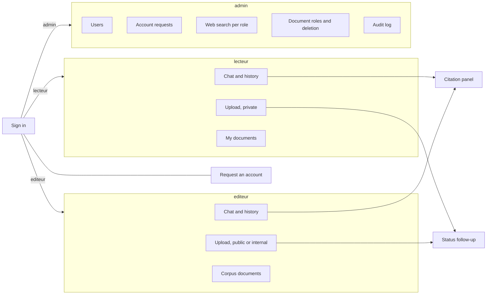

# P7 — Interface

> Status: **draft v0.1**. Read with [`../architecture.md`](../architecture.md) and [`00-shared.md`](00-shared.md). Names, types, IDs, statuses, errors and the signatures of every function shared with other parts are defined in `00-shared.md` and are not repeated here.

---

## 1. Purpose

Give each user the screens they need, **built only on the HTTP API** (00-shared §8): sign in or request an account, ask questions and watch the thinking live, read answers with their citations, upload and manage documents, and, for the admin, manage accounts, requests, the web switch and the audit log. Arabic text displays correctly, right to left.

**P7 enforces nothing.** Hiding a button is for comfort; every rule is enforced by the API. P7 never decides what a user may see.

**P7 chooses its own stack** (Streamlit, Chainlit, React, plain HTML and JavaScript, …). This spec defines what the screens do, not how they are built.

---

## 2. Owns / does not own

| P7 owns | Not P7 (owner) |
|---|---|
| Every screen, its layout and its texts | Every rule: who sees what, who may do what (P5, P2) |
| The API client: token, calls, reading the SSE stream | The API routes and their responses (P5, P2, P3) |
| Showing the thinking block, the answer, citations, confidence | The thinking sentences, the answer, citations, confidence (P4) |
| The web search toggle and remembering it | Whether web search is allowed (P5 role switch, P6 global switch) |
| RTL display and the Arabic font | The `docker compose` file (P6) |
| The `ui` service's `Dockerfile` | |
| The stack choice | |

Code: `src/ui/`. Tests: `tests/ui/` (or the stack's usual test folder, run by CI).

---

## 3. Requirements

MUST = required for validation. SHOULD = expected, can be cut if time runs out.

### 3.1 General

- **P7-01** MUST talk to the system **only** through the HTTP API of 00-shared §8, at `ui.api_base_url`. No direct access to Postgres, Qdrant, files, models or any `src/` module. `ui.api_base_url` is used only by server-side code; a stack running in the browser calls the API through its own origin (`/api/…`), which the `ui` service forwards to `api:8000`.
- **P7-02** MUST run with **no internet access**: every script, stylesheet, font and icon is bundled in the `ui` image. No CDN, no external font service.
- **P7-03** MUST provide `src/ui/Dockerfile` for the `ui` service (P6 adds it to `docker compose`).
- **P7-04** MUST choose the stack by **day 2** and write it, with how to run the UI, in `src/ui/README.md`.

### 3.2 Arabic and RTL

- **P7-05** MUST display every piece of text that may be Arabic (question, answer, thinking, excerpt, title, file name, error message) with `dir="auto"` or the equivalent, so Arabic reads right to left and French left to right, even mixed in one screen.
- **P7-06** MUST keep citation markers and numbers readable inside Arabic text: each marker `[n]` is its own isolated element (`<bdi>` or the equivalent), so it never shows as `]n[`.
- **P7-07** MUST bundle an Arabic font with good Naskh shapes under an open licence (e.g. Noto Naskh Arabic, Amiri) and use it for Arabic text.
- **P7-08** MUST show interface labels in Arabic, with the whole layout right to left. SHOULD offer French labels (left to right) with a switch, remembered in the browser.

### 3.3 Session

- **P7-09** MUST sign in with `POST /auth/login`, keep the token in memory or session storage (never `localStorage`), and send it as `Authorization: Bearer …` on every call.
- **P7-10** MUST call `GET /auth/me` after sign-in and use `role` to choose the screens (§3.9) and `web_available` to show or hide the web toggle.
- **P7-11** MUST go back to the sign-in screen, with a short message, on any `401` (expired token, account disabled). It never retries with a stored password: the password is never stored.
- **P7-12** MUST provide a sign-out action that forgets the token.

### 3.4 Account request

- **P7-13** MUST offer, from the sign-in screen, a "request an account" form calling `POST /auth/account-requests` with `username`, `password` (typed twice, both must match), `full_name`. It checks the rules of `AccountRequestIn` before sending (00-shared §8: username 3–32 characters among letters, digits, `.` `_` `-`; password at least `auth.min_password_length`). The `ui` service reads `auth.min_password_length` and `agents.max_question_chars` from the `config.yaml` mounted by P6.
- **P7-14** MUST show, after `202`: "your request was sent; an administrator will review it". After `409`: "this username is not available". After `429`: "too many requests are waiting; try again later". It never says whether an account or a request exists for a username other than through these messages.

### 3.5 Chat

- **P7-15** MUST send the question with `POST /ask {question, use_web}` and read the SSE stream (00-shared §5.7) as it arrives. A browser `EventSource` can't send a POST body or a header: use a streaming `fetch` (or the stack's streaming HTTP client).
- **P7-16** MUST show `thinking` texts as they arrive in a **collapsible block**, open while the answer is being prepared and collapsed when the `answer` arrives (the user can open it again).
- **P7-17** MUST show the `answer` event:
  - `text` with each marker `[n]` as a clickable element that shows citation `n` (P7-18);
  - the **web notice** (the answer's first line, when present) visibly set apart, e.g. a warning band;
  - `confidence` as a percentage or a bar, for `status = "answered"` only;
  - for `status = "unknown"`, the text alone: no citations, no confidence, no hint;
  - under every `answered` answer, the fixed notice "réponse générée, vérifiez les sources" (in Arabic for an Arabic answer: "إجابة مولَّدة آليًا، يُرجى التحقق من المصادر").
- **P7-18** MUST show each citation with: `title`, `article`, `page`, `source` (when not `null`) and the `excerpt` as a quotation. A web citation (`url` set) shows its link, opened in a new tab with `rel="noopener noreferrer"`, and is marked as coming from the web.
- **P7-19** MUST show an `error` event's `message` in place of the answer, and stop waiting at `done`.
- **P7-20** MUST show the web search toggle next to the question box when `web_available` is true: **on by default**, remembered in the browser, sent as `use_web` with every question. When `web_available` is false, the toggle is hidden and `use_web` is sent as `false`.
- **P7-21** MUST disable the send button while a question is running, and refuse an empty question or one longer than `agents.max_question_chars` before sending (the API refuses it too).
- **P7-22** MUST keep the conversation on screen (questions and answers, newest at the bottom) and save it: create a conversation (`POST /conversations`) at the first question, and after each `answer` event send the question and the `Answer` to `POST /conversations/{conversation_id}/messages`. Each question is still sent alone to `/ask`: earlier exchanges are never sent with it.
- **P7-22b** MUST provide a history list (`GET /conversations`: title, date, newest first) to open an earlier conversation (`GET /conversations/{conversation_id}`), start a new one, or delete one (`DELETE`, after an in-page confirmation). An opened exchange is shown like a live answer (P7-17, P7-18); one with `available = false` shows only its question and the fixed notice of 00-shared §8, with no citation and no confidence.

### 3.6 Documents

- **P7-23** MUST provide an upload form calling `POST /documents` (multipart) with `file`, `title` (required), `source` and `date` (optional); `roles` is sent as repeated form fields:
  - for an `editeur`: a visibility choice, **public** → `roles = ["lecteur", "editeur"]`, **internal** → `roles = ["editeur"]`; no default, the editor must choose;
  - for anyone else: no visibility choice; the form says the document is private, visible only to them.
- **P7-24** MUST accept only the formats P1 accepts (PDF, DOCX, HTML, MD, TXT, PNG, JPG/JPEG, TIFF) in the file picker, and show the API's error otherwise.
- **P7-25** MUST, after `202`, follow the document with `GET /documents/{doc_id}/status` every 2 s until `ready` or `failed`, showing the current step (`received`, `extracting`, `chunked`, `indexed`, `ready`) and, for `failed`, the `error` with "delete the document and upload it again".
- **P7-26** MUST show a warning when `duplicate_of` is not empty: "a document with the same text already exists", with links to those documents' status.
- **P7-27** MUST provide a "documents" list from `GET /documents`: title, original file name, source, status, visibility (public, internal, private), with a delete action (`DELETE /documents/{doc_id}`) after a confirmation **inside the page** (not a browser dialog). The admin gets the same delete action on corpus documents, on the document roles screen. A `409` while processing shows "the document is still being processed".
- **P7-28** MUST offer changing a document's roles only to the roles allowed by the access column of `PUT /admin/documents/{doc_id}/roles` in 00-shared §8 (today: `admin` only, on the admin screen).

### 3.7 Admin

- **P7-29** MUST provide, for the `admin` only:
  - **users**: list (`GET /admin/users`), create (`POST /admin/users`), change role (`PATCH /admin/users/{user_id}/role`), deactivate or reactivate (`PATCH /admin/users/{user_id}/active`);
  - **account requests**: list of `pending` requests (`GET /admin/account-requests?status=pending`) with username, full name, date; approve with a role chosen from `GET /admin/roles` (no default), or reject, each after an in-page confirmation;
  - **web search per role**: one switch per role from `GET /admin/roles`, calling `PATCH /admin/roles/{role_id}/web`;
  - **document roles**: for a corpus document from `GET /documents`, choose public or internal and call `PUT /admin/documents/{doc_id}/roles`, or delete it (`DELETE /documents/{doc_id}`, after an in-page confirmation);
  - **audit log**: `GET /admin/audit`, newest first, showing the fields of `AuditLogResponse` as they come.
- **P7-30** MUST show the admin no chat and no document content: the admin's screens are the ones above.

### 3.8 Safety of what is displayed

- **P7-31** MUST display every text that comes from the API (answer, thinking, excerpt, title, file name, source, error, audit details) as **plain text**: never as HTML, never through a Markdown renderer that allows raw HTML. Document text can contain anything.
- **P7-32** MUST make a link only from a citation's `url`, and only if it starts with `http://` or `https://`. A `source` that looks like a URL is shown as text.
- **P7-33** MUST NOT log, store or send the questions, answers or passwords anywhere other than the API (the history is saved only through `/conversations`). The question box and the displayed conversation are cleared on sign-out.

### 3.9 Screens by role

| Screen | `lecteur` | `editeur` | `admin` | No token |
|---|---|---|---|---|
| Sign in, request an account | | | | ✓ |
| Chat, with the history list | ✓ | ✓ | | |
| Upload | ✓ (private) | ✓ (public / internal) | | |
| Documents | ✓ (own uploads) | ✓ (corpus) | | |
| Users, account requests, web per role, document roles and deletion, audit log | | | ✓ | |



- **P7-34** MUST show each role exactly its screens from this table. A screen the role can't use is not shown, not just disabled.

---

## 4. Contracts provided

| What | Used by |
|---|---|
| The `ui` service (`src/ui/Dockerfile`) | P6 (`docker compose`) |
| The demo screens | Everyone (final demo) |

## 5. Contracts consumed

| What | From | Used for |
|---|---|---|
| `POST /auth/login`, `GET /auth/me`, `POST /auth/account-requests` | P5 | Session, account requests |
| `POST /documents`, `GET /documents`, `GET /documents/{doc_id}/status`, `DELETE /documents/{doc_id}` | P5 | Upload and documents |
| `/admin/*` routes | P5 | Admin screens |
| `POST /ask` (SSE events of 00-shared §5.7) | P3 | Chat |
| `/conversations` routes | P5 | Saving and reopening the history |
| `Answer`, `Citation` | P4, through P3 | Displaying answers |
| `FakeOrchestrator` (`contracts.orchestrator: fake`) | P3 | Building the chat before the real graph exists |
| Error format `{"code", "message"}` and HTTP statuses | 00-shared §7 | Messages |

---

## 6. Pseudocode

Written in Python-like pseudocode; P7 writes it in its chosen stack.

### 6.1 Asking a question

```python
async def ask(question, use_web):
    if not question.strip() or len(question) > MAX_QUESTION_CHARS:
        show_input_error(); return
    disable_send()
    thinking = open_thinking_block()
    try:
        async for event, data in sse_post(f"{API}/ask", {"question": question, "use_web": use_web},
                                          headers=auth()):
            if event == "thinking":
                thinking.append_text(data["text"])                 # plain text, dir="auto"
            elif event == "answer":
                thinking.collapse()
                show_answer(data)                                  # §6.2
            elif event == "error":
                thinking.collapse()
                show_error(data["message"])
            elif event == "done":
                break
    except HttpError as e:
        if e.status == 401: return to_sign_in("session expired")
        show_error(message_for(e))                                 # 422 → "question too long or empty"
    finally:
        enable_send()

async def sse_post(url, body, headers):
    """POST with a streaming response; yields (event, data) for each SSE message."""
    async with http.stream("POST", url, json=body, headers=headers) as r:
        r.raise_for_status()
        event, data = None, []
        async for line in r.lines():
            if line.startswith("event:"):  event = line[6:].strip()
            elif line.startswith("data:"): data.append(line[5:].strip())
            elif line == "" and event:                             # blank line ends a message
                yield event, json.loads("\n".join(data))
                event, data = None, []
```

### 6.2 Showing an answer

```python
def show_answer(a):
    box = answer_box(dir="auto")
    lines = a["text"].split("\n")
    if a["status"] == "answered" and a["citations"] and is_web_notice(lines[0], a):
        box.add_notice(lines[0]); lines = lines[1:]               # the web notice, set apart
    for part in split_on_markers("\n".join(lines)):               # "text [1] text [2]" → pieces
        if part.is_marker:
            box.add_marker(part.n, on_click=lambda n=part.n: show_citation(a["citations"][n - 1]))
        else:
            box.add_text(part.text)                                # plain text, never HTML
    if a["status"] == "answered":
        box.add_confidence(a["confidence"])

def show_citation(c):
    panel = citation_panel(dir="auto")
    panel.add_text(c["title"])
    if c["article"]: panel.add_text(c["article"])
    if c["page"]:    panel.add_text(f"p. {c['page']}")
    if c["source"]:  panel.add_text(c["source"])                   # text, even if it looks like a URL
    panel.add_quote(c["excerpt"])
    if c["url"] and c["url"].startswith(("http://", "https://")):
        panel.add_link(c["url"], new_tab=True, rel="noopener noreferrer", label="web")

def is_web_notice(first_line, a) -> bool:
    return any(c["url"] for c in a["citations"]) and not MARKER.search(first_line)
```

### 6.3 Following an upload

```python
async def upload(file, title, source, visibility):                 # visibility: None for non-editors
    form = {"file": file, "title": title}
    if source:     form["source"] = source
    if visibility: form["roles"] = {"public": ["lecteur", "editeur"], "internal": ["editeur"]}[visibility]   # one field per role
    r = await http.post(f"{API}/documents", files=form, headers=auth())   # 202 {doc_id, status}
    doc_id = r.json()["doc_id"]
    while True:
        s = (await http.get(f"{API}/documents/{doc_id}/status", headers=auth())).json()
        show_status(s["status"], s["error"])
        if s["duplicate_of"]:
            show_duplicate_warning(s["duplicate_of"])
        if s["status"] in ("ready", "failed"):
            break
        await sleep(2)
```

---

## 7. Error handling

| Situation | What P7 shows |
|---|---|
| `401` anywhere | Back to sign in: "session expired, please sign in again" |
| `403` | "you are not allowed to do this" (should not happen: P7-34) |
| `404` | "not found" |
| `409` on upload | "this document was already uploaded" |
| `409` on delete | "the document is still being processed" |
| `409` on account request | "this username is not available" |
| `422` | The API's `message` |
| `429` | "too many requests are waiting; try again later" |
| `503` or no response | "the service is unavailable; try again in a moment" |
| `error` SSE event | Its `message`, in place of the answer |
| Stream ends without `done` | "the answer was interrupted; try again" |

Every message exists in Arabic (and in French if P7-08's switch is built).

**Do NOT:**
- treat a hidden button as security, or decide in the UI what a user may see;
- display API text as HTML, or make a link from anything but a citation's `http(s)` `url`;
- load anything from the internet at runtime (CDN, fonts, icons);
- store the password, or the token in `localStorage`;
- show the admin a chat or document content;
- use browser dialogs (`alert`, `confirm`, `prompt`): confirmations are in the page;
- add a reason to "web search skipped" or rephrase the "I don't know" answer: show P4's text as it is.

---

## 8. Acceptance tests

Automated tests use the stack's usual tool and run in CI; the API is the real one with `contracts.*: fake`, or a mock of it. Tests marked **(manual)** are run from the demo checklist in `docs/demo.md` and ticked on day 8.

| # | Given | When | Then |
|---|---|---|---|
| T1 | A stream `thinking, thinking, answer, done` | `sse_post` | Yields the 4 events in order with their JSON |
| T2 | A stream split in the middle of a message across two network chunks | `sse_post` | Same 4 events |
| T3 | Answer text `"نص [1] ونص [2]."` with 2 citations | `show_answer` | 2 clickable markers; clicking `[2]` shows citation 2 |
| T4 | An answer whose text contains `` | `show_answer` | Shown as text; no element created |
| T5 | A citation with `url = "javascript:alert(1)"` | `show_citation` | No link |
| T6 | A citation with `source = "https://example.ma"` and `url = null` | `show_citation` | `source` shown as text, no link |
| T7 | A web-only answer (first line = `WEB_ONLY`) | `show_answer` | The notice is set apart from the text |
| T8 | `status = "unknown"` | `show_answer` | Text only; no confidence, no citation |
| T9 | `GET /auth/me` → `web_available = false` | Chat screen | No toggle; `/ask` sent with `use_web = false` |
| T10 | Toggle turned off, page reloaded | Chat screen | Toggle still off |
| T11 | Any call returns `401` | — | Sign-in screen; token forgotten |
| T12 | Each role signed in | Menu | Exactly the screens of §3.9 |
| T13 | Signed in as `lecteur` | Upload form | No visibility choice; "private" notice; no `roles` field sent |
| T14 | Signed in as `editeur`, no visibility chosen | Submit | Refused before sending |
| T15 | Status goes `received → extracting → chunked → indexed → ready` (mock) | Upload | Each step shown; polling stops at `ready` |
| T16 | Status response with `duplicate_of = ["…"]` | Upload | Duplicate warning with a link |
| T17 | Account request with two different passwords | Submit | Refused before sending |
| T18 | Account request → `429` | Submit | The "too many requests" message |
| T19 | Mixed Arabic question with French words and the number 12 **(manual)** | Chat | Each block reads in the right direction; `[1]` never shows as `]1[` |
| T20 | Internet cut off on the demo machine **(manual)** | Every screen | Everything loads, the Arabic font included |
| T21 | Full demo path: request an account → admin approves as `lecteur` → sign in → upload a private PDF → ready → ask about it → click a citation **(manual)** | — | Each step works with the real system |
| T22 | Admin turns web off for `lecteur` **(manual)** | `lecteur`'s chat, after reloading | Toggle hidden |
| T23 | Two questions answered (mock) | — | `POST /conversations` once, then `POST …/messages` twice with each question and its `Answer` |
| T24 | `GET /conversations/{id}` with one exchange `available = false` (mock) | Open the conversation | That exchange: question and the fixed notice only, no citation, no confidence; the others shown normally |
| T25 | Ask, reload the page, open the history **(manual)** | — | The conversation is listed and reopens with its citations |

---

## 9. Minimum version vs full version

| Minimum (must work for validation) | Full |
|---|---|
| Sign in, sign out, `401` handling | + account request form |
| Chat with saved conversation history (list, reopen, delete), live thinking, answer, clickable citations, confidence, web toggle | — |
| Upload with status following; documents list with delete | + duplicate warning |
| Admin: account requests, users (create, role, deactivate), document roles and deletion, audit log | + web per role screen |
| RTL with `dir="auto"`, bundled Arabic font, Arabic labels | + French labels with a switch |
| Plain-text display, safe links, offline | — |

---

## 10. Schedule

Day 0 is for reading; building starts on day 1. The whole team's plan is in `../schedule.md`; the **checkpoints** are what this part must have merged by the end of that day.

| Day | Date | Delivered |
|---|---|---|
| 0 | Mon 11-09 | Read the docs; choose the stack |
| 1 | Tue 11-10 | Project skeleton; sign-in screen; streaming read of `/ask` |
| 2 | Wed 11-11 | **Checkpoint:** stack chosen (`src/ui/README.md`); `Dockerfile`; sign-in screen and a chat that streams `FakeOrchestrator`'s events |
| 3 | Thu 11-12 | Chat: thinking block, answer, clickable citations, confidence, web toggle, RTL |
| 4 | Fri 11-13 | Upload and documents; account request form |
| 5 | Sat 11-14 | **Checkpoint:** every screen of §3.9 against the API with fakes; T1–T18 green |
| 6 | Sun 11-15 | Admin screens finished (document deletion included); conversation history (P7-22, P7-22b) on P5's routes; `docs/demo.md` drafted |
| 7 | Mon 11-16 | On the real API |
| 8 | Tue 11-17 | **Checkpoint:** against the real system; `docs/demo.md` checklist written; T19–T22 and T25 ticked; all tests green |
| 9 | Wed 11-18 | **Feature freeze.** Read the first evaluation results; list this part's problems |
| 10 | Thu 11-19 | Tune this part's values (schedule.md §3) and fix bugs · UI checked on the demo machine, internet off; P7 leads the demo |
| 11 | Fri 11-20 | Tuning and fixes; second evaluation run; **report section** on this part drafted (French) |
| 12 | Sat 11-21 | Fixes only, each tested on the demo machine; **demo rehearsal 1** |
| 13 | Sun 11-22 | **Demo rehearsal 2** (morning); submission |
